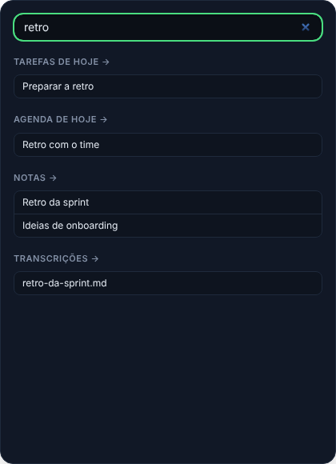
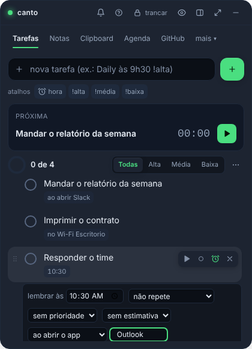
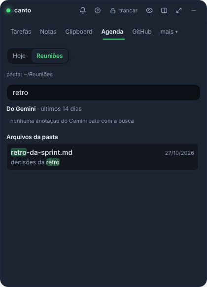
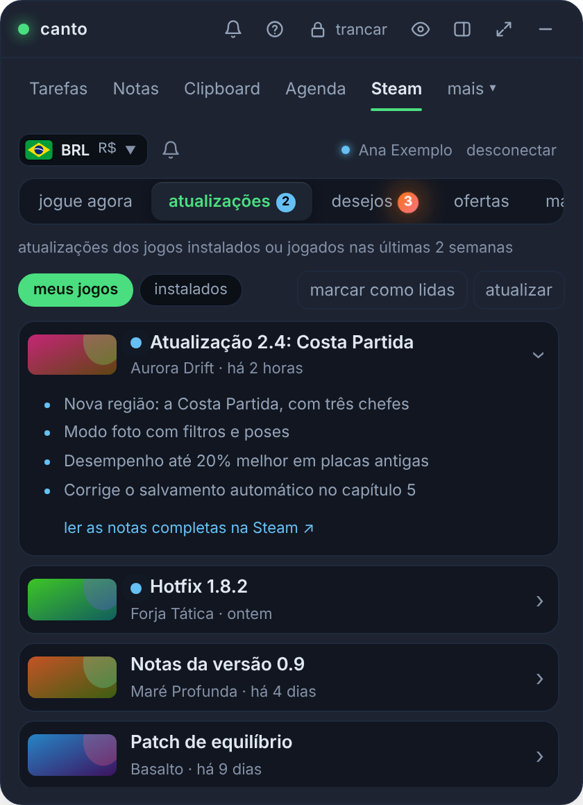
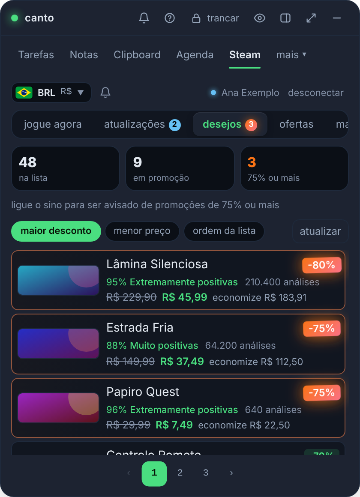
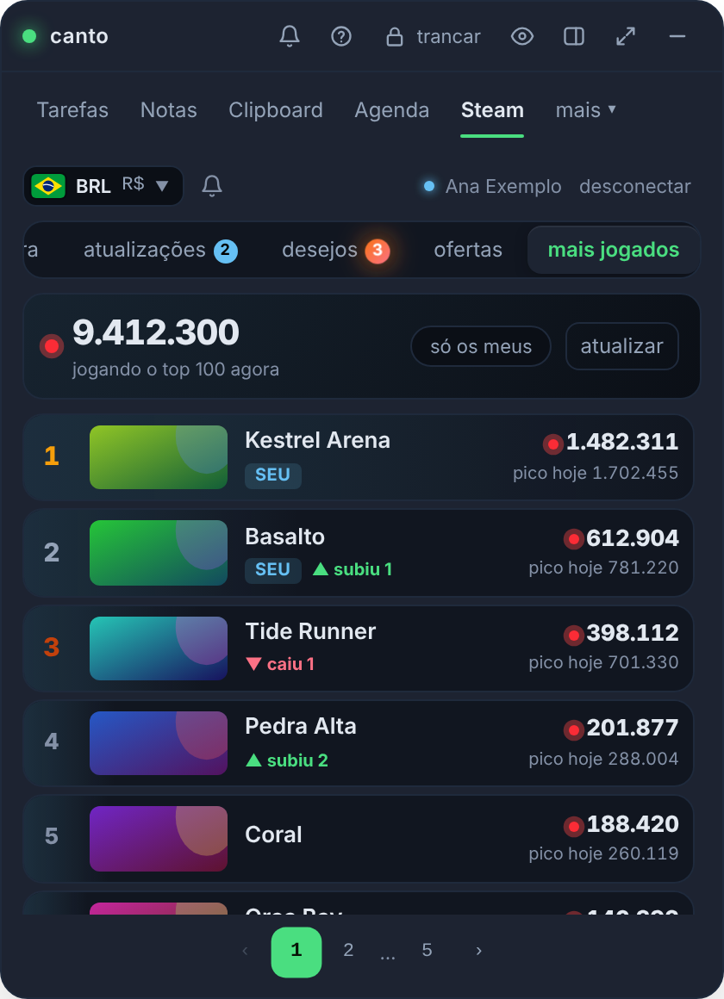

<div align="center">


<br><br>

[](https://github.com/juninmd/canto-widget/releases)

[](https://github.com/juninmd/canto-widget/actions/workflows/ci.yml)
[](LICENSE)
[](https://v2.tauri.app)
[](src-tauri)
[](src)


<sub>[English](README.md) · [Português](README.pt-BR.md) · [Español](README.es.md) · [Français](README.fr.md) · [Italiano](README.it.md) · [日本語](README.ja.md) · [中文](README.zh.md) · [Deutsch](README.de.md) · [Русский](README.ru.md) · [Türkçe](README.tr.md) · [हिन्दी](README.hi.md) · **العربية** · [עברית](README.he.md) · [فارسی](README.fa.md) · [한국어](README.ko.md) · [Nederlands](README.nl.md) · [Polski](README.pl.md) · [Українська](README.uk.md) · [Čeština](README.cs.md) · [Slovenčina](README.sk.md) · [Română](README.ro.md) · [Magyar](README.hu.md) · [Svenska](README.sv.md) · [Dansk](README.da.md) · [Norsk bokmål](README.nb.md) · [Suomi](README.fi.md) · [Ελληνικά](README.el.md) · [Български](README.bg.md) · [Hrvatski](README.hr.md) · [Српски](README.sr.md) · [Slovenščina](README.sl.md) · [Lietuvių](README.lt.md) · [Latviešu](README.lv.md) · [Eesti](README.et.md) · [Bahasa Indonesia](README.id.md) · [Bahasa Melayu](README.ms.md) · [Tiếng Việt](README.vi.md) · [ไทย](README.th.md) · [বাংলা](README.bn.md) · [தமிழ்](README.ta.md) · [Kiswahili](README.sw.md) · [Català](README.ca.md)</sub>

</div>

<br>

> ** المهام التي تحتوي على تذكيرات وملاحظات وسجل الحافظة وجدول أعمال يتضمن تنبيهات الاجتماعات والنصوص وGitHub PRs
> في نافذة صغيرة مثبتة في زاوية الشاشة.** ينبثق بـ `Ctrl+Alt+Space`، ويختفي عندما لا تحتاج إليه
> ويحافظ على كل شيء مشفرًا على جهازك، بدون حساب ولا خادم.

## 🌐 اللغات

يقدم Canto **42 لغة واجهة**، لكل منها ملف README الخاص بها. اختر ما يناسبك في **الإعدادات → اللغة**؛
يستخدم المنتقي القابل للبحث أسماء اللغات الأصلية، ويتبع الوضع التلقائي لغة النظام الأساسية لديك.
تستخدم العربية والعبرية والفارسية نصًا من اليمين إلى اليسار. يتم تحميل كتالوجات اللغات الإضافية عند الطلب.

إن كتالوجات الواجهة الأربعين الجديدة وترجمات README الجديدة البالغ عددها 31 ترجمة هي ترجمات آلية ولم تكن كذلك
تمت المراجعة من قبل المتحدثين الأصليين. تظل البرتغالية والإنجليزية هي كتالوجات الواجهة الأصلية. تسميات صينية و
عناوين الإشعارات تتبع اللغة المحددة؛ تعود بعض تفاصيل تنبيه التكامل إلى اللغة الإنجليزية،
وتظل أخطاء الواجهة الخلفية باللغة البرتغالية. يحافظ بناء جملة عنوان المهمة على الكلمات الأساسية البرتغالية والإنجليزية الموجودة.


## ✨ لماذا Canto

<table>
<tr>
<td width="44%" align="center"></td>
<td>

إذا كنت تعيش بين الاجتماعات، PRs والعناصر الصغيرة المعلقة، فسينتهي بك الأمر مع خمسة تطبيقات مفتوحة. Canto يضع كل شيء في مكانه
مكان واحد.

🔒 **مشفر افتراضيًا.** Argon2id + AES-256-GCM بكلمة مرور رئيسية؛ المفتاح موجود فقط في ذاكرة الوصول العشوائي (RAM).
Windows Hello اختياري.

🏠 **تبقى بياناتك معك.** لا يوجد أي تتبع عن بعد، ولا يوجد خادم، ولا يلزم وجود حساب. النسخ الاحتياطي هو واحد مشفر
`.canto` الملف.

⏰ **لن تفوتك.** قبل دقيقة واحدة من الاجتماع وفي وقت التذكير، تنبثق الأداة، وتقوم بتشغيل صوت و
يرسل إشعارًا يتضمن **غفوة لمدة 10 دقائق**.

🪶 **Light.** Tauri v2 (Rust + عرض ويب النظام) بدلاً من Electron: أداة تثبيت بحجم 3.5 ميغابايت.
[Measured numbers](docs/benchmark.md#footprint-medido).

🔄 **محدث دائمًا.** التحديثات من داخل التطبيق وتثبيت فقط ما تم توقيعه بواسطة مفتاح المشروع الخاص.

</td>
</tr>
</table>

## 🧰 المميزات

<table>
<tr>
<td width="36%"></td>
<td>

### ✅ المهام التي تذكرك

قائمة مرجعية يومية بالوقت والتكرار (كل يوم أو أيام الأسبوع أو أسبوعيًا). اكتب **`Daily at 9:30am`** و
تم ضبط التذكير بالفعل؛ أضف **`!high`** (أو `!alta`، `!média`، `!baixa`) للأولوية، أو انقر فوق النقطة الموجودة في الصف لتدويرها. العناوين الطويلة تلتف بدلاً من أن تتقطع. **مؤقت التركيز** على أي مهمة: قم بتقديرها، ثم اضغط على ◀ وسيقوم شريط مثبت أسفل كل علامة تبويب باحتساب الوقت مقابلها (باللون الأحمر بمجرد تجاوزها)؛ يتم حفظ الوقت في القبو كل دقيقة. **ملخص اليوم** جاهز للصقه (المهام، وقت التركيز، الاجتماعات ذات الوقت الإجمالي، PRs/MRs المفتوحة والمدمجة والمراجعة والمغلقة دون دمج)، و**تقرير أسبوعي وشهري** في عملية التخفيض، و**سحب العناصر المعلقة** من الأمس. **التقاط سريع** (`Ctrl+Alt+N`، `Ctrl+Cmd+N` على نظام التشغيل macOS) يسجل مهمة أو ملاحظة من أي تطبيق، دون فتح الأداة.

</td>
</tr>
<tr>
<td>

### 📅 هل سيبدأ الاجتماع؟ يخبرك.

انضم إلى الاجتماع التالي مع `Ctrl+Alt+M` (`Ctrl+Cmd+M` على نظام التشغيل macOS). إذا فشل التسجيل، Canto يحاول
`Ctrl+Alt+Shift+M` (`Ctrl+Cmd+Shift+M` على نظام التشغيل macOS)؛ تظل قائمة الدرج متاحة في حالة عدم توفرهما.

تأتي أحداث اليوم من تقويم Google (للقراءة فقط). قبل دقيقة واحدة، تنتقل الأداة إلى الشاشة
**انضم إلى Meet**، وقم بتشغيل صوت وإرسال إشعار النظام، بغض النظر عن علامة التبويب التي تستخدمها أو حتى إذا كانت مخفية.
تعرض كل بطاقة شارة بإجابتك (مقبولة، ربما، مرفوضة، في انتظار). انقر فوق الحدث لمعرفة من قام بتنظيمه
ذلك، وجدول الأعمال، وكل ضيف مع الصورة الرمزية للأحرف الأولى وإجابته، والمرفقات، مثل ملاحظات الجوزاء.
يخبرك السطر العلوي بـ **الفتحة المجانية التالية** التي لا تقل عن 15 دقيقة (لا يتم الإبلاغ عن الدعوات المرفوضة والأحداث التي تستمر طوال اليوم)
العد)، والأحداث المتداخلة تحصل على شارة **تعارض** تسمي الحدث الآخر. يؤدي عرض **اليوم** إلى بدء الاجتماع (الوقت المتبقي، زر الانضمام، تحذير الصدام) أو العرض التالي، ثم **اليوم في سطر واحد** (الاجتماعات والمهام ووقت الفراغ عبر ساعات العمل، مع احتساب وقت الاجتماع ووقت الفراغ والتعارضات) ومخطط زمني واحد حيث تكون الاجتماعات والمهام ذات الوقت والفجوات الحرة عبارة عن صفوف خاصة بها: تعرض الفجوة لتناسب مهمة غير محددة بوقت، وما تم تجاوزه بالفعل.

</td>
<td width="36%"></td>
</tr>
<tr>
<td></td>
<td>

### 🗒️ ملاحظات على شكل بطاقات

بطاقات قابلة للبحث مع `#tags`، مثبتة في الأعلى ومرشح العلامات بنقرة واحدة؛ تعرض كل بطاقة بداية الملاحظة **المقدمة** (العناوين، وقوائم المراجعة، والكود، والروابط)، وليس تخفيض السعر الأولي. **محرر WYSIWYG** ذو حجم مضغوط
شريط التنسيق (غامق، مائل، رمز، عنوان، قوائم، قوائم المراجعة التي تحددها مباشرة في النص، كتل التعليمات البرمجية مع بناء الجملة
التمييز والروابط والصور) واختصارات تخفيض السعر أثناء الكتابة (`# `، `- `، `[ ] `، ` ``` `)؛ تبديل **MD**
يعرض تخفيض السعر الأولي، والذي لا يزال يمثل كيفية تخزين الملاحظات والبحث فيها ومزامنتها وتصديرها. الروابط مفتوحة مع
`Ctrl`+نقر، http(s) فقط. قم بلصق أو إسقاط أو إرفاق الصور (PNG، JPEG، GIF، WebP حتى 2 ميجابايت)، كل واحدة مختومة في مكانها
ملف مشفر، يظهر داخل الملاحظة وعلى شكل صور مصغرة على البطاقة؛ يبقون على هذا الجهاز، بالخارج `.canto`
النسخ الاحتياطية. يعالج آلاف الملاحظات: القائمة مقسمة إلى صفحات ويغطي البحث جميعها.

</td>
</tr>
<tr>
<td>

### 📋 الحافظة التي لا تُنسى أبدًا (أو تتسرب)

التاريخ المشفر مع البحث والدبوس. يتعرف على الروابط والألوان والتعليمات البرمجية. قم بتمرير عنصر ما **لنسخه بعد إعادة كتابته**:
بتنسيق JSON أو مضغوط، نص على سطر واحد، بأحرف كبيرة أو صغيرة (يظل إدخال السجل كما كان). النسخة العملاقة (سجل 100 ميجابايت) لا تفعل ذلك
تجميد أي شيء: فهو يحافظ على البداية ويحذرك. على نظام التشغيل Windows، فإنه يتخطى أي شيء يضعه مديرو كلمات المرور على أنه
حساس.

</td>
<td></td>
</tr>
<tr>
<td></td>
<td>

### 🐙 GitHub الخاص بك في لمحة

**المراجعة المطلوبة مني**، المخصصة لي، PRs والمشكلات التي فتحتها، مع PR أو رمز المشكلة ومن فتحها
ذلك. تبرز المسودات، PRs **في انتظار مراجعتك** وPRs **المتوقفة** لمدة أسبوع، وكل PR تحمل قطعة صغيرة
** شارة CI ** (ناجحة أو فاشلة أو قيد التشغيل أو لا يوجد CI) من فحوصات الالتزام الرئيسية الخاصة بها. عندما يطلب شخص ما ** الخاص بك
مراجعة**، يخبرك إشعار نظام التشغيل (يتم تشغيله بشكل افتراضي، قم بإيقاف تشغيله في الإعدادات). قم بالتصفية حسب النص، `repo:` أو `label:`، PRs فقط أو الأعداد فقط، والفرز حسب التحديث أو الإنشاء أو التعليقات، و
قم بالتمرير باستخدام **إظهار المزيد**. قم بالتبديل إلى عرض **التعليقات** لرؤية شبكة **كتالوج المعلقين** لكل من علقوا على PRs (الصور الرمزية، وشارات الإنسان مقابل الروبوت، وعدد التعليقات، والبحث، وفلتر الروبوت، والصفحات التقدمية) وتعليقاتهم. يدعم أيضًا **GitLab.com وGitLab** المستضاف ذاتيًا، مع ذاكرة تخزين مؤقت مدتها 5 دقائق
يحترم الحد الأقصى للسعر. قم بتسجيل الدخول باستخدام رمز شخصي للقراءة فقط أو من المتصفح (تدفق الجهاز).

</td>
</tr>
<tr>
<td></td>
<td>

### 🎮 Steam دون مغادرة القطعة

أربع علامات تبويب فرعية لـ Steam: **صفقات قائمة الرغبات** (الخصم الأكبر أولاً، كل منها بما توفره)، **الأكثر مبيعًا**
مرتبة، **العب الآن** (كل لعبة Steam تقدم تقريرًا خلال الأسبوعين الماضيين) و **الكتالوج مرتب حسب التصنيف**، مقسم إلى صفحات
مع **تحميل المزيد** حتى يصل إلى بقية المتجر. يحتوي كل صف على **صورة الكبسولة** و**نتيجة المراجعة**
مع صياغة Steam الخاصة وعدد المراجعات التي يتم احتسابها، والسعر المشطوب، والسعر بالريال وما هو
يحفظ الخصم - وتضيف القائمة إجمالي التوفير. القوائم العامة تحتاج فقط إلى **SteamID64**; اختياري
يضيف مفتاح **Steam الويب API** أحدث الألعاب وأوقات اللعب الخاصة بها. تبدأ علامة التبويب بشكل افتراضي، على بعد خانة اختيار واحدة
في الإعدادات.

</td>
</tr>
<tr>
<td>

### ⚙️ الإعدادات والتحديثات التلقائية

تغيير كلمة المرور الرئيسية، Windows Hello، `.canto` النسخ الاحتياطي، مجلد متزامن مع الدمج التلقائي (Dropbox،
OneDrive، Syncthing...)، ابدأ بالنظام وقسم **التحديثات**، مع **الإصدار المثبت** و
**أحدث المنشورات** جنبًا إلى جنب وزر للتحديث وإعادة التشغيل.

</td>
<td></td>
</tr>
</table>

تحتوي أيضًا على 🎙️ **الاجتماعات**، وهي علامة تبويب فرعية لجدول الأعمال بجوار القائمة واليوم: ملاحظات الجوزاء والنصوص من
الأسبوعين الماضيين، بالإضافة إلى نصوص `.vtt` و`.srt` و`.txt` و`.md` من مجلد محلي، نظيفة وقابلة للبحث.

🤖 **نماذج الذكاء الاصطناعي** (في شريط علامات التبويب بشكل افتراضي، **لا يوجد مفتاح أو حساب API**): تم تصنيف ماجستير إدارة الأعمال حسب
[Artificial Analysis](https://artificialanalysis.ai) **مؤشر الذكاء**، يمكن قراءته من صفحة لوحة المتصدرين العامة،
مع شريط النتائج، والمنشئ، والسعر لكل مليون رمز وسرعة، يمكن فرزها حسب الذكاء أو السعر أو السرعة. يجلب عند
على الأغلب مرة واحدة كل 3 ساعات، وسيقوم خيار الاشتراك 🔔 بإعلامك عند حدوث
النموذج **يدخل أعلى 10** أو **يتسلق داخلها** (يتم تحديده كل 6 ساعات عندما يكون القبو مفتوحًا)، مع
شارات "جديدة" و"أعلى" لمدة أسبوع.

🌙 **عدم الإزعاج:** في الإعدادات أو الدرج، يمكنك كتم صوت تنبيهات الاجتماعات وتذكيرات المهام وتنبيهات الحالة وكل شيء
إشعار النظام لمدة 30 دقيقة، ساعة واحدة، ساعتين، حتى الغد أو حتى تقوم بإيقاف تشغيله. يظهر القمر في الشريط العلوي
عندما ينتهي؛ نقرة واحدة تؤدي إلى إيقاف تشغيله. إنه ينجو من إعادة التشغيل وينتهي من تلقاء نفسه.

🔔 **كل تنبيه في شاشة واحدة:** يفتح الجرس الموجود في الرأس (العد واللون عند وجود أي شيء معلق)
تنبيهات على النافذة بأكملها في أي وضع: بطاقة واحدة لكل تنبيه مع إجراءاته، **تجاهل الكل**، وما كان
تم حلها اليوم بموجبها - مع عدم وجود أي شيء معلق، فهذه هي الطريقة التي لا تزال تصل بها إلى سجل اليوم. من قفص الاتهام، نقرة واحدة
لا يزال يفتح هذا التنبيه الفردي أعلى النافذة العادية.

⌨️ **كل شيء عن طريق لوحة المفاتيح:** `Alt+1`...`Alt+7` تبديل علامات التبويب، `N` إنشاء، `/` عمليات بحث، `F11` ملء الشاشة، `Alt+L`
الأقفال و`?` يسرد الاختصارات. `Ctrl+Shift+P` (`Cmd+Shift+P` على نظام التشغيل macOS) يفتح **لوحة الأوامر** مع كل
الإجراء بالاسم: انتقل إلى علامة تبويب أو مهمة أو ملاحظة جديدة، وانضم إلى الاجتماع التالي، وانسخ ملخص اليوم، وقم بتبديل المظهر، والقفل.

## 🎨 ستة جلود

<table>
<tr>
<td align="center"><br><b>Default</b></td>
<td align="center"><br><b>Hueco Mundo</b></td>
<td align="center"><br><b>دراكولا</b></td>
<td align="center"><br><b>Glass</b></td>
<td align="center"><br><b>Light</b></td>
</tr>
</table>

و **نظام المتابعة** الذي يقوم بالتبديل بين الضوء والظلام مع نظام التشغيل. كل تمرير التباين AA.

<details>
<summary>🖥️ المزيد من الشاشات: الإعداد، البحث الشامل، لوحة الأوامر، GitLab، المهام الفرعية، محرر الملاحظات، الأمان، المزامنة، الكثافة والمزيد</summary>

<br>


| ترحيب لأول مرة | بحث عالمي (`Ctrl+K`) | علامة التبويب GitLab ذاتية الاستضافة | تنبيه الاجتماع |
|---|---|---|---|
|  |  |  |  |

| Context reminder on a task | Search result jumping to a transcript |
|---|---|
|  |  |

| مهمة ذات مهام فرعية وأولوية وPR | محرر الملاحظات | المزيد من أنواع الحافظة | الأمان: القفل التلقائي وفتح القفل |
|---|---|---|---|
|  |  |  |  |

| المجلد المتزامن | كثافة مدمجة | قبو مقفل | تواصل GitHub |
|---|---|---|---|
|  |  |  |  |

| الإعدادات في مجموعات، مع البحث | البحث يقوم بتصفية المجموعات | شريحة غير متصلة بالإنترنت في الرأس | قم بالتأكيد قبل مسح الحافظة |
|---|---|---|---|
|  |  |  |  |

| تجاهل مسودة ملاحظة غير محفوظة |
|---|
|  |

| الأوضاع: صغير، مخفي، عادي، مكبر | الوضع المصغر: تنبيهات على حافة الشاشة |
|---|---|
|  |  |

| انقر فوق تنبيه في قفص الاتهام | مكبر: النافذة بأكملها لعلامة التبويب المفتوحة |
|---|---|
|  |  |

| الجرس يفتح التنبيهات على كامل النافذة |
|---|
|  |

| Mini: تفتح قائمة الوضع داخل نافذة الإرساء |
|---|
|  |

| علامات التبويب غير المناسبة تنتظر في قائمة "المزيد" |
|---|
|  |

| Vertical tabs: every tab in reach, in groups | Settings > Appearance: pick the tab layout |
|---|---|
|  |  |

| Tasks: progress ring, priority chips, a menu for the rest | Notes: tag chips with counts, list or grid |
|---|---|
|  |  |

| Clipboard: type chips and cards by kind | Agenda: one control row and a countdown ring |
|---|---|
|  |  |

| GitHub: the numbers are filters | Status API: services by severity |
|---|---|
|  |  |

| Status API: my endpoints | AI models: sort chips | Activity: the focus goal |
|---|---|---|
|  |  |  |

| AI models: the full sheet | AI models: Compare | AI models: metric by metric |
|---|---|---|
|  |  |  |

| الألعاب وملء الشاشة: التنبيهات تنتظر حتى تغادر |
|---|
|  |

| الغفوة: 1 أو 5 أو 10 دقائق |
|---|
|  |

| A window that fails shows itself instead of blocking clicks invisibly |
|---|
|  |

| تذكير بالمهمة | تغيير كلمة المرور الرئيسية | الحالة API (علامة تبويب الاشتراك) | اللغة: الإنجليزية أو البرتغالية أو الإسبانية |
|---|---|---|---|
|  |  |  |  |

| نسخ مقطع إعادة كتابته | تنبيه الاجتماع مع الإعدادية |
|---|---|
|  |  |

| إعادة التصميم: علامة التبويب "المهام"، قبل وبعد |
|---|
|  |

| إعادة التصميم: كل علامة تبويب، قبل (أعلى) وبعد (أسفل) |
|---|
|  |

| فشل CI، مع الوظائف المعطلة | ذكرني أحد | مفاتيحهم في الإعدادات |
|---|---|---|
|  |  |  |

| تنبيه الذكر مع من كتبه |
|---|
|  |

| تنبيه بالذكر مع معاينة النص |
|---|
|  |

| المزيد من التنبيهات حول أعمالي الخاصة |
|---|
|  |

| PR assigned to me |
|---|
|  |

| تنبيه ملخص اليوم | إعداد ملخص اليوم |
|---|---|
|  |  |

| علامة التبويب الفرعية للإشارات (GitHub وGitLab) |
|---|
|  |

| تم تغيير كلمة المرور، هناك ملف واحد معلق | ملخص اليوم |
|---|---|
|  |  |

| التقرير الأسبوعي | جدول الأعمال: وقت الفراغ القادم والصراعات |
|---|---|
|  |  |

| جدول الأعمال: مجاني الآن | لوحة الأوامر (`Ctrl+Shift+P`) |
|---|---|
|  |  |

| لا تزعج | صورة في مذكرة |
|---|---|
|  |  |

| شارة CI على كل PR | إشعارات طلب المراجعة |
|---|---|
|  |  |

| لاحظ الصور كصور مصغرة | محرر الملاحظات WYSIWYG |
|---|---|
|  |  |

| محرر الملاحظات: تخفيض السعر الخام (MD) | محرر الملاحظات على البشرة الفاتحة |
|---|---|
|  |  |

| المهام: الأولوية على الصف، التفاف العناوين الطويلة | قائمة الملاحظات مع تخفيض السعر المقدم |
|---|---|
|  |  |

| نماذج الذكاء الاصطناعي مرتبة حسب مؤشر الذكاء |
|---|
|  |

| Steam: the changelog of your games' updates | Steam: the wishlist with sales of 75% or more highlighted |
|---|---|
|  |  |

| Steam: the most played games right now | Steam: play now as a list and as a grid |
|---|---|
|  |  |

| Steam: wishlist deals | Steam: the top sellers, numbered |
|---|---|
|  |  |

| تراكب تنبيه واحد لكل شيء معلق: الانقطاعات والاجتماعات والمهام ونماذج الذكاء الاصطناعي الجديدة |
|---|
|  |

</details>

| نقاط النهاية الخاصة بي: المربعات ذات زمن الوصول الأخير | نقطة نهاية مفتوحة: مخطط زمن الوصول وإعدادات الحد والتنبيه | إضافة DNS + فحص الشهادة |
|---|---|---|
|  |  |  |

| جدول أعمال أي يوم: الأسهم السابقة والتالية ومنتقي التاريخ وزر العودة إلى اليوم |
|---|
|  |

| المهام: المهمة الحالية مع مؤقت وقائمة مجمعة | GitHub: شريط التلخيص أعلى القوائم | GitLab: نفس الشريط، بدون بلاط CI |
|---|---|---|
|  |  |  |

| مؤقت التركيز مثبت أسفل كل علامة تبويب | جدول الأعمال كيوم، والمهام بجانب الاجتماعات |
|---|---|
|  |  |

| عرض اليوم: الأحداث المتداخلة تشترك في العرض جنبًا إلى جنب |
|---|
|  |

| رادار المراجعة: الطلب الأقدم أولاً، تأخر موعد تقديمه باللون الأحمر، غفوة |
|---|
|  |

| الاجتماعات كعلامة تبويب فرعية في جدول الأعمال، بجوار القائمة واليوم |
|---|
|  |

| علامة تبويب النشاط (متوقفة بشكل افتراضي) | ملخص مع وقت التركيز ومغلق PRs/MRs |
|---|---|
|  |  |

| علامة تبويب النشاط، آخر 7 أيام | علامة تبويب النشاط، متوقفة | علامة تبويب النشاط في نافذة واسعة |
|---|---|---|
|  |  |  |

تبدأ علامة التبويب **النشاط** مخفية (قم بتشغيلها ضمن الإعدادات → علامات التبويب المرئية). ويسجل فقط اسم
تطبيق مركز أثناء استخدام الكمبيوتر، في ملف محلي مغلق لا يصل أبدًا إلى النسخ الاحتياطية أو المزامنة (Wayland
لا يمكن الإبلاغ عن النافذة التي تم التركيز عليها، لذا تظل غير متاحة هناك). إيقاف حتى تقوم بالاشتراك، والشاشة الأولى تقول ماذا
يتم الاحتفاظ به وما لا يكون أبدًا.

- **اليوم**: كعكة دائرية حسب الفئة مع الإجمالي بداخلها، والذي يخفي مفتاحه فئة ما، والتغيير مقابل اليوم
قبل ووقت الخمول (لا تستخدم لوحة المفاتيح أو الماوس لمدة دقيقتين). أسفله، يوجد هدف يومي للتركيز على الكود مع خطه و
نقطة واحدة في اليوم، وثلاث نقاط بارزة (أطول امتداد في تطبيق واحد، ومفاتيح التطبيق، وساعة الذروة)، ومخطط زمني حيث يتم عرض الكل
في اليوم، تشترك فترات الخمول والتطبيقات الأكثر ازدحامًا في محور زمني واحد مع علامة "الآن" وقائمة من التطبيقات
(انقر فوق واحدة لتغيير فئتها) أو المهام التي تم تشغيل مؤقت التركيز عليها.
- **الأسبوع**: أعمدة مكدسة يوميًا مع خط المتوسط ونقطة أسفل كل يوم حقق الهدف، وخريطة حرارية لمدة ساعة
مع ذروتك، ونفس القوائم طوال الأسبوع.
- **التخطيط والأسطح**: عمود واحد في النافذة الافتراضية، وعمودان عندما تصبح واسعة (تكبير)؛ كل بشرة لها خاصتها
ألوان الفئة، والتحقق من التباين. تقوم القائمة المجاورة لليوم بنسخها كنص.

<sub>جميع لقطات الشاشة تستخدم بيانات وهمية.</sub>

## ⚖️ مقارنة بما هو موجود هناك

ولا تغطي أي من الأدوات التي تم بحثها أكثر من اثنتين من هذه الجبهات في وقت واحد. المصادر والتفاصيل في
[docs/benchmark.md](docs/benchmark.md).

| | مهام + تذكير | ملاحظات | الحافظة | اجتماعات | GitHub | التشفير المحلي بشكل افتراضي |
|---|:-:|:-:|:-:|:-:|:-:|:-:|
| **Canto** | ✅ | ✅ | ✅ | ✅ | ✅ | ✅ |
| تودويست / تيك تيك | ✅ | ➖ | — | — | — | — |
| سبج / جوبلين | ➖ | ✅ | — | — | — | ➖ مزامنة فقط |
| رايكاست | ➖ | ✅ | ✅ | ➖ | ➖ | ؟ |
| CopyQ / كما سبق | — | — | ✅ | — | — | ➖ اختياري |
| شريط الاجتماعات | — | — | — | ✅ | — | غير متوفر |
| جيتيفاي | — | — | — | — | ✅ | غير متوفر |

<sub> ✅ أصلي · ➖ جزئي، عبر الامتداد أو اختياري · — لا شيء · ? غير منشورة · غير متاح لا يقوم بتخزين بيانات المستخدم</sub>

ما جلبه المعيار هنا: **الوقت المناسب في عنوان المهمة** (Todoist/TickTick)، **أجل التنبيه**
(TickTick) و**الحافظة التي تحترم مديري كلمات المرور** (CopyQ/Ditto).

## ⬇️ التثبيت

قم بتنزيل برنامج التثبيت لنظامك الأساسي من **[Releases](https://github.com/juninmd/canto-widget/releases)**:

| النظام | ملف |
|---|---|
| 🪟 ويندوز 10/11 | `Canto_x.y.z_x64-setup.exe` (مستحسن) أو `.msi` |
| 🍎 ماك | `.dmg` لشركة Apple Silicon أو Intel |
| 🐧 لينكس | `.AppImage`، `.deb` أو `.rpm` |

1. عند التشغيل لأول مرة، يمكنك إنشاء **كلمة المرور الرئيسية**. لا يوجد استرداد: تفقد كلمة المرور، وتفقد البيانات.
2. يعرض `Ctrl+Alt+Space` (`Cmd+Shift+Space` على نظام التشغيل macOS) الأداة ويخفيها.
3. تم. عند إصدار إصدار جديد، يقوم Canto بإعلامك، ويتم تحديث **الإعدادات → التحديثات** بنقرة واحدة.

> [!ملاحظة]
> لم يتم توقيع المثبتات بالرمز بعد: يتم تحذير SmartScreen (Windows) وGatekeeper (macOS) عند التشغيل لأول مرة.
> يتم التحقق من التحديثات التلقائية مقابل توقيع المشروع قبل التشغيل.

البيانات الجاهزة لـ Winget وHomebrew (بالإضافة إلى هيكل عظمي لـ Flatpak، المحظورة حاليًا).
[`packaging/`](packaging/README.md) — تم إعداده والتحقق منه محليًا، ولكن لم يتم نشره لهم بعد
المستودعات: النشر هو قرار وإجراء يدوي من قبل المشرف.

## 🔒 الأمن في لمحة

| طبقة | الحماية |
|---|---|
| قبو | Argon2id (19 MiB, t=2) → AES-256-GCM، نونس جديد في كل كتابة، كتابة ذرية باستخدام `fsync` |
| مفتاح | ذاكرة الوصول العشوائي (RAM) فقط، مثبتة على القفل؛ قفل تلقائي قابل للتكوين (من 5 إلى 60 دقيقة في وضع الخمول، و15 دقيقة بشكل افتراضي) |
| الشبكة | فقط عملية Rust تتحدث إلى الشبكة؛ لا يحتوي عرض الويب على أصل بعيد (CSP) ولا يرى الرموز المميزة |
| Google | اختياري، فقط `calendar.events.readonly`، `directory.readonly` (صور زملاء العمل في قائمة الضيوف) بالإضافة إلى الملف الشخصي، OAuth مع PKCE والاسترجاع |
| GitHub | رمز اختياري مشفر؛ يتم فتح العناصر فقط إذا كان الرابط `https://github.com/` |
| GitLab | عنوان ورمز اختياري ومشفر؛ `https://` فقط، لا توجد عمليات إعادة توجيه، روابط فقط من المثيل الذي تم تكوينه |
| التحديثات | يقوم فقط بتثبيت الحزمة الموقعة بواسطة مفتاح المشروع؛ يتم تجاهل التنزيل الذي تم العبث به قبل تشغيل |

النموذج الكامل والنسخ الاحتياطي والدمج عبر الأجهزة ومكان وجود كل ملف: [docs/seguranca.md](docs/seguranca.md).
وجدت الخلل؟ [SECURITY.md](SECURITY.md).

## 📚 التوثيق

| وثيقة | ما فيه |
|---|---|
| 📖 [User guide](docs/uso.md) | علامات التبويب والمهام المتكررة والاختصارات والجلود وإمكانية الوصول والنافذة والتحديثات والبدء بالنظام |
| 📱 [Mobile](docs/mobile.md) | Android / iOS |
| 🔌 [Integrations](docs/integracoes.md) | Google جدول الأعمال و GitHub (الرمز الشخصي أو تدفق الجهاز) |
| 🛡️ [Security and data](docs/seguranca.md) | نموذج التهديد، `.canto` النسخ الاحتياطي، الدمج، تغيير كلمة المرور، الملفات الموجودة على القرص |
| 📊 [Benchmark](docs/benchmark.md) | Todoist، TickTick، Obsidian، Joplin، Raycast، PowerToys، CopyQ، Ditto، MeetingBar، Gitify واختبارات مستوى الصوت |
| 📝 [CHANGELOG](CHANGELOG.md) | ما تغير في كل نسخة |
| 🤝 [How to contribute](CONTRIBUTING.md) | البيئة والاختبارات وPRs وكيفية نشر الإصدار |
| 🤖 [Agent guide](AGENTS.md) | العقود والفخاخ لأي شخص يقوم بتحرير الكود باستخدام الذكاء الاصطناعي |

## 🛠️ التطوير

المتطلبات الأساسية: [Bun](https://bun.sh) ≥ 1.2، مستقر Rust ≥ 1.85 و
[Tauri v2 dependencies](https://v2.tauri.app/start/prerequisites/) لنظامك.

```bash
bun install
bun run tauri dev                                        # app with hot reload
bun run lint && bun test                                 # types and UI tests
bun run build && cd src-tauri && cargo clippy --all-targets -- -D warnings && cargo test
bun run tauri build                                      # installer for the current platform
```

يتم إنشاء عروض الويب بعد حالة Rust ويتم تهيئة الدرج، لذا لا يمكن لاستدعاءات IPC عند بدء التشغيل أن تتنافس مع الإعداد.

يقوم كل PR بتشغيل CI على أنظمة التشغيل Windows وmacOS وLinux. تم دمج `fix` التقليدي و`feat` وكسر الالتزامات في `main`
الحصول على علامة SemVer وملاحظات الإصدار التي تم إنشاؤها والمثبتات الموقعة المضمنة بالتوازي؛ يتم نشر الإصدار بعد التحقق (التفاصيل في
[CONTRIBUTING.md](CONTRIBUTING.md#publicar-uma-versão)).

## 📄 الترخيص

[MIT](LICENSE) © أنطونيو كارلوس

<div align="center"><sub>مصنوع باستخدام 🦀 Rust و⚛️ React و☕ لأولئك الذين يعيشون بين الاجتماعات.</sub></div>
