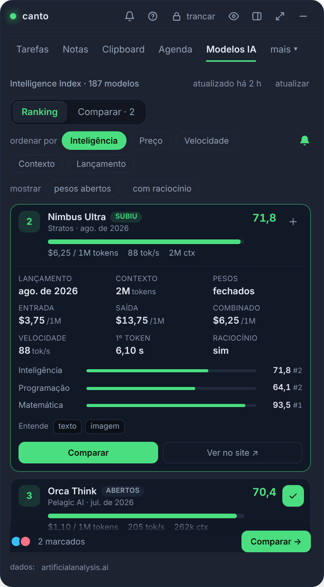
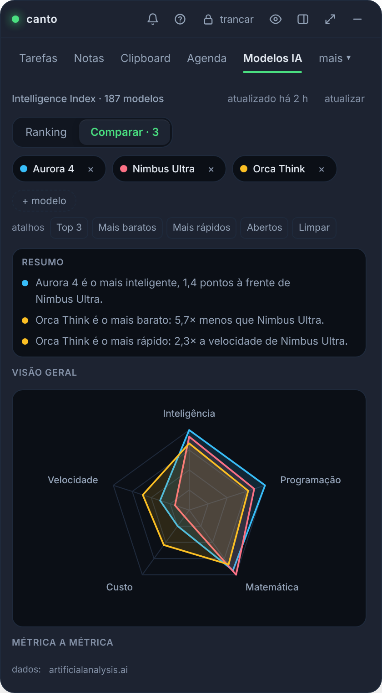
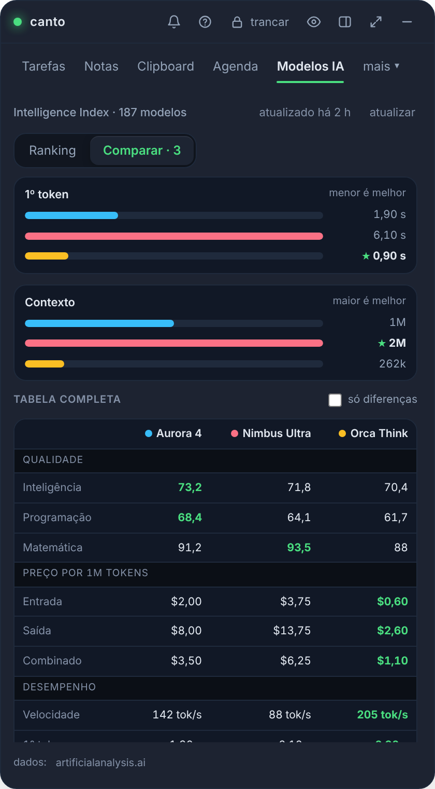

<div align="center">


<br><br>

[](https://github.com/juninmd/canto-widget/releases)

[](https://github.com/juninmd/canto-widget/actions/workflows/ci.yml)
[](LICENSE)
[](https://v2.tauri.app)
[](src-tauri)
[](src)


<sub>[English](README.md) · [Português](README.pt-BR.md) · [Español](README.es.md) · [Français](README.fr.md) · [Italiano](README.it.md) · [日本語](README.ja.md) · [中文](README.zh.md) · [Deutsch](README.de.md) · [Русский](README.ru.md) · [Türkçe](README.tr.md) · [हिन्दी](README.hi.md) · [العربية](README.ar.md) · [עברית](README.he.md) · [فارسی](README.fa.md) · [한국어](README.ko.md) · [Nederlands](README.nl.md) · [Polski](README.pl.md) · [Українська](README.uk.md) · **Čeština** · [Slovenčina](README.sk.md) · [Română](README.ro.md) · [Magyar](README.hu.md) · [Svenska](README.sv.md) · [Dansk](README.da.md) · [Norsk bokmål](README.nb.md) · [Suomi](README.fi.md) · [Ελληνικά](README.el.md) · [Български](README.bg.md) · [Hrvatski](README.hr.md) · [Српски](README.sr.md) · [Slovenščina](README.sl.md) · [Lietuvių](README.lt.md) · [Latviešu](README.lv.md) · [Eesti](README.et.md) · [Bahasa Indonesia](README.id.md) · [Bahasa Melayu](README.ms.md) · [Tiếng Việt](README.vi.md) · [ไทย](README.th.md) · [বাংলা](README.bn.md) · [தமிழ்](README.ta.md) · [Kiswahili](README.sw.md) · [Català](README.ca.md)</sub>

</div>

<br>

> **Úkoly s připomenutími, poznámkami, historií schránky, agendou s upozorněními na schůzky, přepisy a vašimi GitHub PRs
> v malém okně připnutém k rohu obrazovky.** Zobrazí se s `Ctrl+Alt+Space`, skryje se, když nepotřebujete
> to a uchovává vše zašifrované na vašem počítači, bez účtu a serveru.

## 🌐 Jazyky

Canto nabízí **42 jazyků rozhraní**, každý s vlastním README. Vyberte si svůj v **Nastavení → Jazyk**;
prohledávatelný výběr používá názvy v rodném jazyce a automatický režim se řídí vaším primárním jazykem systému.
Arabština, hebrejština a perština používají text zprava doleva. Další jazykové katalogy se načítají na vyžádání.

40 nových katalogů rozhraní a 31 nových překladů README jsou strojové překlady a dosud nebyly
recenzované rodilými mluvčími. Portugalština a angličtina zůstávají původní katalogy rozhraní. Zásobníkové štítky a
nadpisy oznámení se řídí zvoleným jazykem; některé podrobnosti upozornění na integraci se vrátí do angličtiny,
a backend chyby zůstávají v portugalštině. Syntaxe názvu úlohy zachovává stávající portugalská a anglická klíčová slova.


## ✨ Proč Canto

<table>
<tr>
<td width="44%" align="center"></td>
<td>

Pokud žijete mezi schůzkami, PRs a malými nevyřízenými položkami, skončíte s pěti otevřenými aplikacemi. Canto dává všechno
jedno místo.

🔒 **Ve výchozím nastavení šifrováno.** Argon2id + AES-256-GCM s hlavním heslem; klíč existuje vždy pouze v paměti RAM.
Windows Hello volitelné.

🏠 **Vaše data zůstanou s vámi.** Nulová telemetrie, nulový server, není potřeba žádný účet. Záloha je jednorázově zašifrovaná
`.canto` soubor.

⏰ **Už to nezmeškáte.** 1 minutu před schůzkou a v době připomenutí se widget objeví, přehraje zvuk a
odešle upozornění s **odložením o 10 minut**.

🪶 **Světlo.** Tauri v2 (Rust + webové zobrazení systému) namísto Electron: 3,5 MB instalační program.
[Measured numbers](docs/benchmark.md#footprint-medido).

🔄 **Vždy aktuální.** Aktualizuje se z aplikace a instaluje pouze to, co je podepsáno vlastním klíčem projektu.

</td>
</tr>
</table>

## 🧰 Funkce

<table>
<tr>
<td width="36%"></td>
<td>

### ✅ Úkoly, které vám připomínají

Denní kontrolní seznam s časem a opakováním (každý den, ve všední dny nebo týdně). Zadejte **`Daily at 9:30am`** a
připomínka je již nastavena; přidejte **`!high`** (nebo `!alta`, `!média`, `!baixa`) pro prioritu, nebo kliknutím na tečku na řádku jej cyklujte. Dlouhé nadpisy se zabalí místo toho, aby byly odříznuty. **Časovač zaostření** na jakýkoli úkol: zadejte odhad, stiskněte ▶ a pruh připnutý pod každou záložkou odpočítává čas (červený, jakmile přejdete); čas se ukládá do trezoru každou minutu. **Shrnutí dne** připraveno k vložení (úkoly, soustředěný čas, schůzky s celkovým časem, PRs/MRs otevřeno, sloučeno, zkontrolováno a uzavřeno bez sloučení), **týdenní a měsíční zpráva** ve snížení a **přetažení nevyřízených položek** ze včerejška. **Rychlé snímání** (`Ctrl+Alt+N`, `Ctrl+Cmd+N` na macOS) zaznamenává úkol nebo poznámku z libovolné aplikace, aniž by bylo nutné otevřít widget.

</td>
</tr>
<tr>
<td>

### 📅 Začíná schůzka? Říká vám to.

Připojte se k další schůzce s `Ctrl+Alt+M` (`Ctrl+Cmd+M` na macOS). Pokud se registrace nezdaří, pokusí se Canto
`Ctrl+Alt+Shift+M` (`Ctrl+Cmd+Shift+M` v systému macOS); nabídka zásobníku zůstane dostupná, pokud nejsou obě dostupné.

Dnešní události pocházejí z kalendáře Google (pouze pro čtení). Před minutou widget skočí na obrazovku s
**připojte se k Meet**, přehraje zvuk a odešle systémové upozornění, bez ohledu na to, na které kartě se nacházíte, nebo i když je skrytá.
Každá karta zobrazuje odznak s vaší odpovědí (přijato, možná, odmítnuto, čeká). Kliknutím na událost zjistíte, kdo ji zorganizoval
to, program, každý host s iniciálami avataru a jeho odpovědí a přílohami, jako jsou Blížence poznámky.
V horním řádku je uveden **další volný slot** v délce alespoň 15 minut (odmítnuté pozvánky a celodenní akce ne
počet) a události, které se překrývají, získají odznak **konflikt** s názvem druhé události. Zobrazení **Dnes** vede probíhající schůzkou (zbývající čas, tlačítko připojit se, varování před střetem) nebo další, poté **den v jednom řádku** (schůzky, úkoly a volný čas v rámci pracovní doby, se započítáním času na schůzky, volný čas a konflikty) a jedna časová osa, kde jsou schůzky, úkoly s časem a volné mezery samy o sobě řadami: mezera nabízí, aby se vešla nečasovaná úloha.

</td>
<td width="36%"></td>
</tr>
<tr>
<td></td>
<td>

### 🗒️ Poznámky jako karty

Prohledávatelné karty s `#tags`, připnutím nahoru a filtrem značek na jedno kliknutí; každá karta zobrazuje začátek poznámky **vykreslený** (názvy, kontrolní seznamy, kód, odkazy), nikoli hrubé označení. **WYSIWYG editor** s kompaktem
formátovací řádek (tučné, kurzíva, kód, nadpis, seznamy, kontrolní seznamy, které zaškrtnete přímo v textu, bloky kódu se syntaxí
zvýrazňování, odkazy, obrázky) a označovací zkratky při psaní (`# `, `- `, `[ ] `, ` ``` `); přepínač **MD**
ukazuje hrubé markdown, což je stále způsob, jakým se poznámky ukládají, prohledávají, synchronizují a exportují. Odkazy se otevírají pomocí
`Ctrl`+kliknutí, pouze http(s). Vložte, vložte nebo připojte obrázky (PNG, JPEG, GIF, WebP až do velikosti 2 MB), každý uzavřený ve svém
zašifrovaný soubor, zobrazený uvnitř poznámky a jako miniatury na kartě; zůstávají na tomto stroji mimo `.canto`
zálohy. Zvládá tisíce poznámek: seznam je stránkovaný a vyhledávání pokrývá všechny.

</td>
</tr>
<tr>
<td>

### 📋 Schránka, která se nikdy nezapomene (nebo nevyteče)

Šifrovaná historie s vyhledáváním a pinem; rozpoznává odkazy, barvy a kód. Umístěním kurzoru na položku ji **zkopírujte přepsanou**:
JSON formátovaný nebo kompaktní, text na jednom řádku, VELKÁ nebo malá písmena (položka historie zůstane tak, jak byla). Obrovská kopie (100 MB log) ne
zmrazit cokoliv: zachová start a upozorní vás. V systému Windows přeskočí všechna hesla, která správci označí jako
citlivý.

</td>
<td></td>
</tr>
<tr>
<td></td>
<td>

### 🐙 Vaše GitHub na první pohled

**Vyžádaná kontrola ode mě**, přidělená mně, PRs a problémy, které jsem otevřel, s PR nebo ikonou problému a kdo otevřel
to. Koncepty, PRs **čekající na vaši recenzi** a PRs **zastavení** na týden vynikají a každý PR nese malý
**Odznak CI** (úspěšný, neúspěšný, běžící nebo žádný CI) z kontrol hlavního odevzdání. Když někdo **požaduje vaše
review**, upozorní vás na to upozornění OS (ve výchozím nastavení zapnuto, v Nastavení vypněte). Filtrujte podle textu, `repo:` nebo `label:`, pouze PRs nebo pouze problémů, seřaďte podle aktualizace, vytvoření nebo komentářů a
rolujte pomocí **zobrazit více**. Přepněte do zobrazení **Komentáře** a zobrazte tabulku **Katalog komentátorů** všech, kteří okomentovali vaše PRs (avataři, odznaky mezi lidmi vs roboty, počty komentářů, vyhledávání, filtr botů, progresivní stránkování) a jejich komentáře. Podporuje také **GitLab.com a samostatně hostovaný GitLab** s 5minutovou mezipamětí, která
respektuje limit sazby. Přihlaste se pomocí osobního tokenu pouze pro čtení nebo z prohlížeče (tok zařízení).

</td>
</tr>
<tr>
<td></td>
<td>

### 🎮 Steam aniž byste opustili widget

Čtyři podkarty pro Steam: **nabídky na přání** (největší sleva jako první, každá s tím, co ušetří), **nejprodávanější**
hodnoceno, **hrát hned** (každá hra Steam hlásí za poslední dva týdny) a **katalog seřazený podle hodnocení**, stránkovaný
s **načíst více**, aby se dostal do zbytku obchodu. Každý řádek nese **obrázek kapsle**, **skóre recenze**
s vlastním zněním Steam a kolik recenzí se počítá, přeškrtnutá cena, cena v reálu a co
sleva ušetří — a seznam sečte celkovou úsporu. Veřejné seznamy potřebují pouze vaše **SteamID64**; volitelný
**Steam Web API klíč** přidává nejnovější hry s jejich hracími časy. Karta se ve výchozím nastavení spustí, o jedno zaškrtávací políčko
v Nastavení.

</td>
</tr>
<tr>
<td>

### ⚙️ Nastavení a automatické aktualizace

Změna hlavního hesla, Windows Hello, záloha `.canto`, synchronizovaná složka s automatickým sloučením (Dropbox,
OneDrive, Syncthing...), začněte systémem a sekcí **Aktualizace**, **nainstalovanou verzí** a
**nejnovější zveřejněné** vedle sebe a tlačítko pro aktualizaci a restart.

</td>
<td></td>
</tr>
</table>

Má také 🎙️ **Schůzky**, podzáložku Agenda vedle Seznam a Den: Blíženci poznámky a přepisy z
poslední dva týdny plus `.vtt`, `.srt`, `.txt` a `.md` přepisy z místní složky, vyčištěné a prohledávatelné.

🤖 **Modely AI** (ve výchozím nastavení na liště karet, **žádný klíč nebo účet API**): LLM seřazené podle
[Artificial Analysis](https://artificialanalysis.ai) **Intelligence Index**, přečteno z jeho veřejné stránky žebříčku,
s ukazatelem skóre, tvůrcem, cenou za 1 milion tokenů a rychlostí, seřazenými podle inteligence, ceny nebo rychlosti. Vyzvedává se v
většinou jednou za 3 hodiny a přihlášení 🔔 vás upozorní, když a
model **vstoupí do top 10** nebo **vstoupí do ní** (kontrolováno každých 6 hodin, když je trezor odemčen),
"nové" a "nahoru" odznaky na týden.

🌙 **Nerušit:** v Nastavení nebo na panelu můžete ztišit upozornění na schůzky, připomenutí úkolů, upozornění na stav a další
systémové upozornění po dobu 30 min, 1 h, 2 h, do zítřka nebo dokud jej nevypnete. Zobrazí se měsíc v horní liště
když skončí; jedním kliknutím jej opět vypnete. Přežije restart a skončí sám.

🔔 **Každé upozornění na jedné obrazovce:** zvonek v záhlaví (počet a barva, když něco čeká) otevře
výstrahy přes celé okno v libovolném režimu: jedna karta na výstrahu s jejími akcemi, **zavřít vše** a co bylo
vyřešeno dnes pod nimi — bez čekání, takto se stále dostanete k dnešnímu protokolu. Z doku, kliknutí
stále otevře toto jediné upozornění v horní části normálního okna.

⌨️ **Vše pomocí klávesnice:** `Alt+1`…`Alt+7` přepínání karet, `N` vytváření, `/` vyhledávání, `F11` celá obrazovka, `Alt+L`
zámky a `?` uvádí seznam zkratek. `Ctrl+Shift+P` (`Cmd+Shift+P` na macOS) otevře **paletu příkazů** s každým
akce podle názvu: přejděte na kartu, nový úkol nebo poznámku, připojte se k další schůzce, zkopírujte shrnutí dne, přepněte vzhled, uzamkněte.

## 🎨 Šest skinů

<table>
<tr>
<td align="center"><br><b>Výchozí</b></td>
<td align="center"><br><b>Hueco Mundo</b></td>
<td align="center"><br><b>Dracula</b></td>
<td align="center"><br><b>Sklo</b></td>
<td align="center"><br><b>Světlo</b></td>
</tr>
</table>

A **Follow system**, který spolu s OS přepíná mezi světlem a tmou. Všechny projdou AA kontrastem.

<details>
<summary>🖥️ Další obrazovky: registrace, globální vyhledávání, paleta příkazů, GitLab, dílčí úkoly, editor poznámek, zabezpečení, synchronizace, hustota a další</summary>

<br>


| První spuštění vítáno | Globální vyhledávání (`Ctrl+K`) | Samoobslužná karta GitLab | Upozornění na schůzku |
|---|---|---|---|
|  |  |  |  |

| Úkol s dílčími úkoly, prioritou a PR | Editor poznámek | Více typů schránky | Zabezpečení: automatické zamykání a odemykání |
|---|---|---|---|
|  |  |  |  |

| Synchronizovaná složka | Kompaktní hustota | Uzamčený trezor | Připojte GitHub |
|---|---|---|---|
|  |  |  |  |

| Nastavení ve skupinách, s vyhledáváním | Vyhledávání filtruje skupiny | Offline čip v záhlaví | Před vymazáním schránky potvrďte |
|---|---|---|---|
|  |  |  |  |

| Zahodit neuložený koncept poznámky |
|---|
|  |

| Režimy: Mini, Skrytý, Normální, Maximalizovaný | Mini režim: upozornění na okraji obrazovky |
|---|---|
|  |  |

| Klikněte na upozornění v doku | Maximalizováno: celé okno pro otevřenou kartu |
|---|---|
|  |  |

| Zvonek otevírá upozornění přes celé okno |
|---|
|  |

| Mini: nabídka režimu se otevře uvnitř dokovacího okna |
|---|
|  |

| Záložky, které se nevejdou, čekají v nabídce "více" |
|---|
|  |

| Vertical tabs: every tab in reach, in groups | Settings > Appearance: pick the tab layout |
|---|---|
|  |  |

| Tasks: progress ring, priority chips, a menu for the rest | Notes: tag chips with counts, list or grid |
|---|---|
|  |  |

| Clipboard: type chips and cards by kind | Agenda: one control row and a countdown ring |
|---|---|
|  |  |

| GitHub: the numbers are filters | Status API: services by severity |
|---|---|
|  |  |

| Status API: my endpoints | AI models: sort chips | Activity: the focus goal |
|---|---|---|
|  |  |  |

| AI models: the full sheet | AI models: Compare | AI models: metric by metric |
|---|---|---|
|  |  |  |

| Hry a celá obrazovka: upozornění čekají, až odejdete |
|---|
|  |

| Odložení: 1, 5 nebo 10 minut |
|---|
|  |

| A window that fails shows itself instead of blocking clicks invisibly |
|---|
|  |

| Připomenutí úkolu | Změnit hlavní heslo | Stav API (záložka pro přihlášení) | Jazyk: angličtina, portugalština nebo španělština |
|---|---|---|---|
|  |  |  |  |

| Zkopírujte přepsaný klip | Upozornění na schůzku s přípravou |
|---|---|
|  |  |

| Přepracování: karta Úkoly, před a po |
|---|
|  |

| Redesign: každá záložka, před (nahoře) a za (dole) |
|---|
|  |

| CI se nezdařilo, s přerušenými úlohami | Někdo se o mně zmínil | Jejich přepínače v Nastavení |
|---|---|---|
|  |  |  |

| Uveďte upozornění, kdo to napsal |
|---|
|  |

| Zmínit upozornění s náhledem textu |
|---|
|  |

| Další upozornění o mé vlastní práci |
|---|
|  |

| PR assigned to me |
|---|
|  |

| Denní souhrnné upozornění | Nastavení souhrnu dne |
|---|---|
|  |  |

| Podzáložka Zmínky (GitHub a GitLab) |
|---|
|  |

| Heslo změněno, čeká se na jeden soubor | Shrnutí dne |
|---|---|
|  |  |

| Týdenní zpráva | Agenda: příští volný čas a konflikty |
|---|---|
|  |  |

| Agenda: zdarma hned teď | Paleta příkazů (`Ctrl+Shift+P`) |
|---|---|
|  |  |

| Nerušit | Obrázek v poznámce |
|---|---|
|  |  |

| Odznak CI na každém PR | Oznámení žádostí o kontrolu |
|---|---|
|  |  |

| Poznamenejte si obrázky jako miniatury | WYSIWYG editor poznámek |
|---|---|
|  |  |

| Editor poznámek: raw markdown (MD) | Editor poznámek na světlé kůži |
|---|---|
|  |  |

| Úkoly: priorita na řádku, zalomení dlouhých nadpisů | Seznam poznámek s vykresleným označením dolů |
|---|---|
|  |  |

| Modely umělé inteligence hodnocené podle indexu inteligence |
|---|
|  |

| Steam: nejprodávanější, očíslované | Steam: posledních pět odehraných her, s oběma hracími časy |
|---|---|
|  |  |

| Steam: katalog podle hodnocení, s "načíst více" | | Steam: the library, most played first, with a search box |
|---|---|
|  |  |

| Jedno překryvné upozornění pro vše čekající: výpadky, schůzky, úkoly a nové modely umělé inteligence |
|---|
|  |

</details>

| Moje koncové body: dlaždice s nejnovější latencí | Otevřený koncový bod: graf latence, limit a nastavení výstrah | Přidání kontroly certifikátu DNS + |
|---|---|---|
|  |  |  |

| Program libovolného dne: předchozí a následující šipky, výběr data a tlačítko zpět na dnešek |
|---|
|  |

| Úkoly: aktuální úkol s časovačem a seskupeným seznamem | GitHub: souhrnný pruh nad seznamy | GitLab: stejný pás, bez dlaždice CI |
|---|---|---|
|  |  |  |

| Časovač ostření připnutý pod každou záložkou | Agenda jako den, úkoly vedle porad |
|---|---|
|  |  |

| Denní pohled: překrývající se události sdílejí šířku vedle sebe |
|---|
|  |

| Kontrola radaru: nejdříve nejstarší požadavek, zpožděný červeně, odložit |
|---|
|  |

| Schůzky jako podzáložka Agenda vedle seznamu a dne |
|---|
|  |

| Záložka Aktivita (ve výchozím nastavení vypnutá) | Shrnutí se zaměřeným časem a uzavřeným PRs/MRs |
|---|---|
|  |  |

| Karta Aktivita, posledních 7 dní | Karta Aktivita, vypnutá | Karta aktivity v širokém okně |
|---|---|---|
|  |  |  |

Karta **Aktivita** se spustí skrytě (zapněte ji v části Nastavení → viditelné karty). Zaznamenává pouze název
zaměřená aplikace, když používáte počítač, v zapečetěném místním souboru, který nikdy nedosáhne zálohy nebo synchronizace (Wayland
nemůže nahlásit zaměřené okno, takže tam zůstane nedostupné). Vypnuto, dokud se nepřihlásíte a první obrazovka neřekne co
je zachováno a co nikdy není.

- **Den**: kobliha podle kategorie s celkovým počtem uvnitř, jejíž legenda skrývá kategorii, změnu oproti dni
před a po dobu nečinnosti (bez klávesnice nebo myši po dobu 2 minut). Pod ním denní cíl zaměřený na kód s pruhem a
jedna tečka za den, tři zvýraznění (nejdelší úsek v jedné aplikaci, přepínání aplikací, špička), časová osa, kde
den, nečinné úseky a nejvytíženější aplikace sdílejí jednu časovou osu se značkou „nyní“ a seznamem aplikací
(klepnutím na jednu změníte její kategorii) nebo úkolů, na kterých časovač ostření běžel.
- **Týden**: složené sloupce za den s průměrnou čarou a tečkou pod každým dnem, který splnil cíl, hodinová teplotní mapa
s vaším vrcholem a stejné seznamy na celý týden.
- **Rozvržení a vzhledy**: jeden sloupec ve výchozím okně, dva, jakmile je široké (maximální); každá kůže má své
barvy kategorie, zkontrolován kontrast. Nabídka vedle dne jej zkopíruje jako text.

<sub>Všechny snímky obrazovky používají fiktivní data.</sub>

## ⚖️ V porovnání s tím, co je venku

Žádný ze zkoumaných nástrojů nepokrývá více než dvě z těchto front najednou. Zdroje a podrobnosti v
[docs/benchmark.md](docs/benchmark.md).

| | Úkoly + připomenutí | Poznámky | Schránka | Setkání | GitHub | Místní šifrování ve výchozím nastavení |
|---|:-:|:-:|:-:|:-:|:-:|:-:|
| **Canto** | ✅ | ✅ | ✅ | ✅ | ✅ | ✅ |
| Todoist / TickTick | ✅ | ➖ | — | — | — | — |
| Obsidián / Joplin | ➖ | ✅ | — | — | — | ➖ pouze synchronizace |
| Raycast | ➖ | ✅ | ✅ | ➖ | ➖ | ? |
| CopyQ / Ditto | — | — | ✅ | — | — | ➖ volitelné |
| MeetingBar | — | — | — | ✅ | — | n/a |
| Gitify | — | — | — | — | ✅ | n/a |

<sub>✅ nativní · ➖ částečné, přes rozšíření nebo volitelně · — žádné · ? nepublikováno · neukládá uživatelská data</sub>

Co sem benchmark přinesl: **čas přímo v názvu úkolu** (Todoist/TickTick), **odložení upozornění**
(TickTick) a **schránka, která respektuje správce hesel** (CopyQ/Ditto).

## ⬇️ Nainstalujte

Stáhněte si instalační program pro vaši platformu z **[Releases](https://github.com/juninmd/canto-widget/releases)**:

| Systém | Soubor |
|---|---|
| 🪟 Windows 10/11 | `Canto_x.y.z_x64-setup.exe` (doporučeno) nebo `.msi` |
| 🍎 macOS | `.dmg` pro Apple Silicon nebo Intel |
| 🐧 Linux | `.AppImage`, `.deb` nebo `.rpm` |

1. Při prvním spuštění vytvoříte **hlavní heslo**. Neexistuje žádná obnova: ztratit heslo, ztratit data.
2. `Ctrl+Alt+Space` (`Cmd+Shift+Space` v systému macOS) zobrazí a skryje widget.
3. Hotovo. Když se dodává nová verze, Canto vás upozorní a **Nastavení → Aktualizace** se aktualizuje jedním kliknutím.

> [!POZNÁMKA]
> Instalační programy ještě nejsou podepsané kódem: SmartScreen (Windows) a Gatekeeper (macOS) varují při prvním spuštění.
> Automatické aktualizace jsou před spuštěním ověřeny podle vlastního podpisu projektu.

Hotové manifesty pro winget a Homebrew (plus kostra pro Flatpak, aktuálně blokovaná) žijí v
[`packaging/`](packaging/README.md) – připraveno a ověřeno lokálně, ale dosud nebylo zveřejněno
repozitáře: publikování je ruční rozhodnutí a akce správce.

## 🔒 Bezpečnost na první pohled

| Vrstva | Ochrana |
|---|---|
| Trezor | Argon2id (19 MiB, t=2) → AES-256-GCM, nový zápis při každém zápisu, atomový zápis s `fsync` |
| Klíč | Pouze RAM, vynulováno na zámku; konfigurovatelný automatický zámek (5 až 60 minut nečinnosti, 15 minut ve výchozím nastavení) |
| Síť | pouze proces Rust mluví se sítí; webview nemá vzdálený původ (CSP) a nikdy nevidí tokeny |
| Google | volitelné, pouze `calendar.events.readonly`, `directory.readonly` (fotografie kolegů z Workspace v seznamu hostů) plus profil, OAuth s PKCE a zpětnou smyčkou |
| GitHub | volitelný, šifrovaný token; položky se otevírají, pouze pokud je odkaz `https://github.com/` |
| GitLab | volitelná, šifrovaná adresa a token; Pouze `https://`, žádná přesměrování, odkazy pouze z nakonfigurované instance |
| Aktualizace | nainstaluje pouze balíček podepsaný klíčem projektu; manipulované stahování je před spuštěním zahozeno |

Úplný model, zálohování, sloučení mezi počítači a umístění každého souboru: [docs/seguranca.md](docs/seguranca.md).
Našli jste chybu? [SECURITY.md](SECURITY.md).

## 📚 Dokumentace

| Dokument | Co je v něm |
|---|---|
| 📖 [User guide](docs/uso.md) | karty, opakující se úlohy, zástupce, vzhledy, usnadnění, okna, aktualizace a start se systémem |
| 📱 [Mobile](docs/mobile.md) | Android / iOS |
| 🔌 [Integrations](docs/integracoes.md) | Google agenda a GitHub (osobní token nebo tok zařízení) |
| 🛡️ [Security and data](docs/seguranca.md) | model ohrožení, `.canto` zálohování, sloučení, změna hesla, soubory na disku |
| 📊 [Benchmark](docs/benchmark.md) | Todoist, TickTick, Obsidian, Joplin, Raycast, PowerToys, CopyQ, Ditto, MeetingBar, Gitify a objemové testy |
| 📝 [CHANGELOG](CHANGELOG.md) | co se změnilo v každé verzi |
| 🤝 [How to contribute](CONTRIBUTING.md) | prostředí, testy, PRs a jak publikovat vydání |
| 🤖 [Agent guide](AGENTS.md) | smlouvy a pasti pro každého, kdo upravuje kód pomocí AI |

## 🛠️ Vývoj

Předpoklady: [Bun](https://bun.sh) ≥ 1,2, stabilní Rust ≥ 1,85 a
[Tauri v2 dependencies](https://v2.tauri.app/start/prerequisites/) pro váš systém.

```bash
bun install
bun run tauri dev                                        # app with hot reload
bun run lint && bun test                                 # types and UI tests
bun run build && cd src-tauri && cargo clippy --all-targets -- -D warnings && cargo test
bun run tauri build                                      # installer for the current platform
```

Webviews se vytvářejí po stavu Rust a zásobník je inicializován, takže spouštěcí IPC volání nemohou závodit s nastavením.

Každý PR provozuje CI na Windows, macOS a Linux. Konvenční `fix`, `feat` a porušující commity sloučeny do `main`
získat značku SemVer, vygenerované poznámky k verzi a podepsané instalační programy vytvořené paralelně; vydání je zveřejněno po ověření (podrobnosti v
[CONTRIBUTING.md](CONTRIBUTING.md#publicar-uma-versão)).

## 📄 Licence

[MIT](LICENSE) © Antonio Carlos

<div align="center"><sub>Vyrobeno s 🦀 Rust, ⚛️ React a ☕ pro ty, kteří žijí mezi setkáními.</sub></div>
