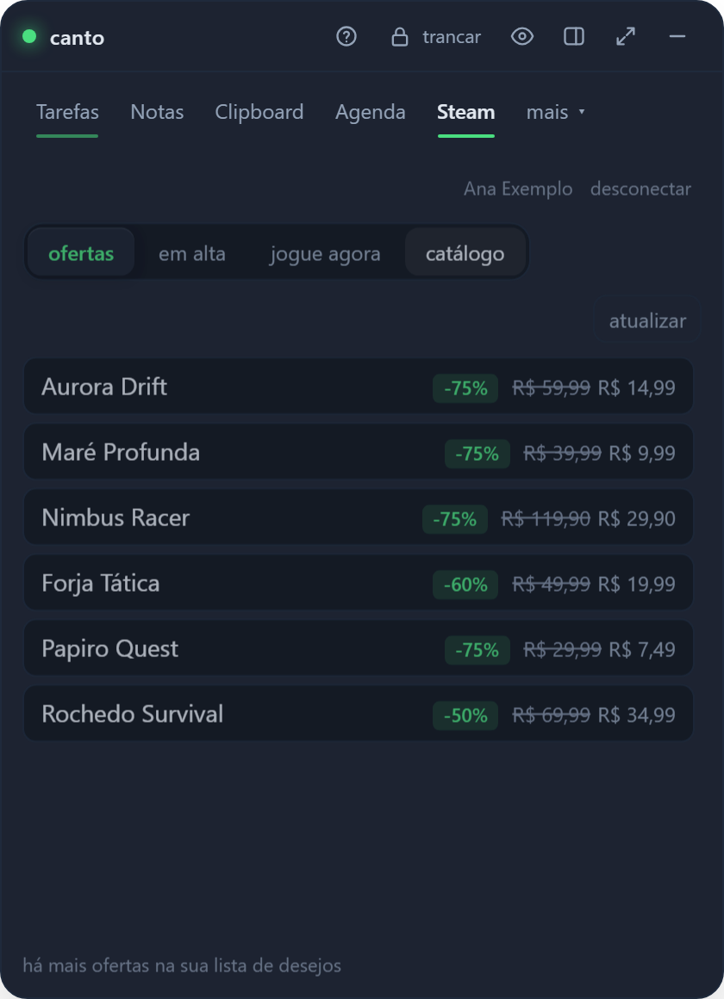
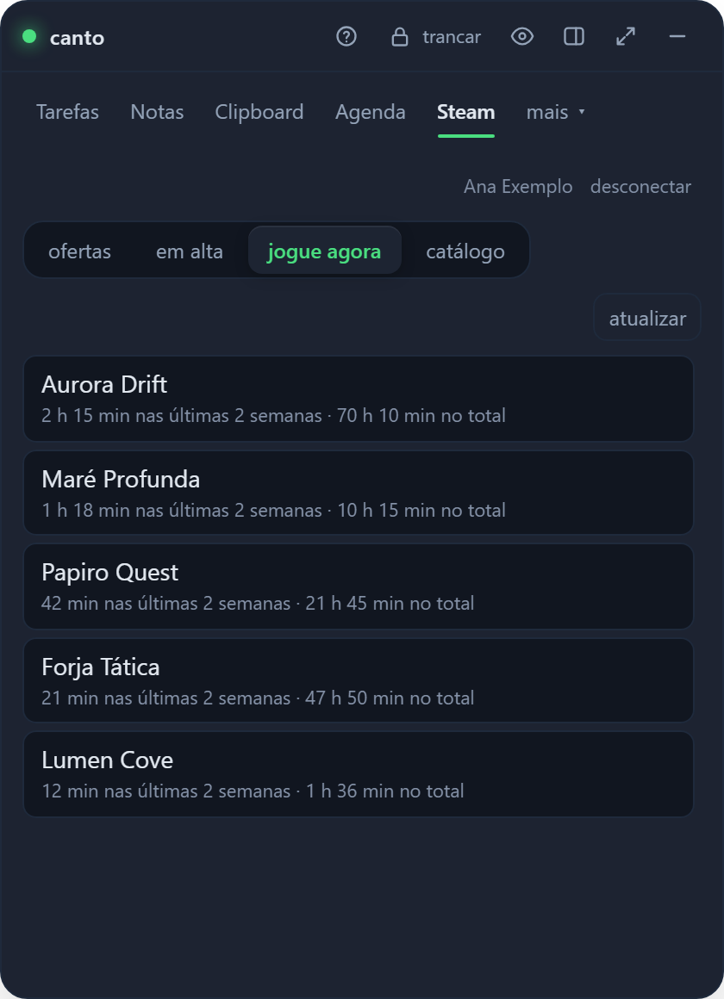

<div align="center">


<br><br>

[](https://github.com/juninmd/canto-widget/releases)

[](https://github.com/juninmd/canto-widget/actions/workflows/ci.yml)
[](LICENSE)
[](https://v2.tauri.app)
[](src-tauri)
[](src)


<sub>[English](README.md) · [Português](README.pt-BR.md) · [Español](README.es.md) · [Français](README.fr.md) · [Italiano](README.it.md) · [日本語](README.ja.md) · [中文](README.zh.md) · [Deutsch](README.de.md) · [Русский](README.ru.md) · [Türkçe](README.tr.md) · [हिन्दी](README.hi.md) · [العربية](README.ar.md) · [עברית](README.he.md) · [فارسی](README.fa.md) · [한국어](README.ko.md) · [Nederlands](README.nl.md) · **Polski** · [Українська](README.uk.md) · [Čeština](README.cs.md) · [Slovenčina](README.sk.md) · [Română](README.ro.md) · [Magyar](README.hu.md) · [Svenska](README.sv.md) · [Dansk](README.da.md) · [Norsk bokmål](README.nb.md) · [Suomi](README.fi.md) · [Ελληνικά](README.el.md) · [Български](README.bg.md) · [Hrvatski](README.hr.md) · [Српски](README.sr.md) · [Slovenščina](README.sl.md) · [Lietuvių](README.lt.md) · [Latviešu](README.lv.md) · [Eesti](README.et.md) · [Bahasa Indonesia](README.id.md) · [Bahasa Melayu](README.ms.md) · [Tiếng Việt](README.vi.md) · [ไทย](README.th.md) · [বাংলা](README.bn.md) · [தமிழ்](README.ta.md) · [Kiswahili](README.sw.md) · [Català](README.ca.md)</sub>

</div>

<br>

> **Zadania z przypomnieniami, notatkami, historią schowka, planem zajęć z alertami o spotkaniach, transkrypcjami i Twoim GitHub PRs
> w małym okienku przypiętym do rogu ekranu.** Wyskakuje z `Ctrl+Alt+Space`, chowa się, gdy nie potrzebujesz
> go i przechowuje wszystko zaszyfrowane na Twoim komputerze, bez konta i bez serwera.

## 🌐 Języki

Canto oferuje **42 języki interfejsu**, każdy z własnym plikiem README. Wybierz swój w **Ustawienia → Język**;
selektor z możliwością przeszukiwania używa nazw języków rodzimych, a tryb automatyczny podąża za głównym językiem systemu.
W języku arabskim, hebrajskim i perskim tekst jest pisany od prawej do lewej. Dodatkowe katalogi językowe ładują się na żądanie.

40 nowych katalogów interfejsów i 31 nowych tłumaczeń README są tłumaczeniami maszynowymi i tak nie było
recenzowane przez native speakerów. Portugalski i angielski pozostają oryginalnymi katalogami interfejsów. Etykiety na tace i
nagłówki powiadomień są zgodne z wybranym językiem; niektóre szczegóły alertów dotyczących integracji odnoszą się do języka angielskiego,
i błędy backendu pozostają w języku portugalskim. Składnia tytułu zadania zachowuje istniejące portugalskie i angielskie słowa kluczowe.


## ✨ Dlaczego Canto

<table>
<tr>
<td width="44%" align="center"></td>
<td>

Jeśli żyjesz pomiędzy spotkaniami, PRs i małymi oczekującymi sprawami, ostatecznie masz otwartych pięć aplikacji. Canto przedstawia wszystko
jedno miejsce.

🔒 **Domyślnie szyfrowane.** Argon2id + AES-256-GCM z hasłem głównym; klucz zawsze istnieje tylko w pamięci RAM.
Windows Hello opcjonalne.

🏠 **Twoje dane pozostają przy Tobie.** Zero telemetrii, zero serwera, konto nie jest wymagane. Kopia zapasowa jest pojedyncza, zaszyfrowana
`.canto` plik.

⏰ **Nie przegapisz tego.** 1 minutę przed spotkaniem oraz w momencie przypomnienia widget wyskakuje, odtwarza dźwięk i
wysyła powiadomienie z opcją **drzemka 10 min**.

🪶 **Light.** Tauri v2 (Rust + przeglądanie systemu) zamiast Electron: instalator 3,5 MB.
[Measured numbers](docs/benchmark.md#footprint-medido).

🔄 **Zawsze aktualne.** Aktualizuje się z poziomu aplikacji i instaluje tylko to, co jest podpisane własnym kluczem projektu.

</td>
</tr>
</table>

## 🧰 Funkcje

<table>
<tr>
<td width="36%"></td>
<td>

### ✅ Zadania, które Ci przypominają

Codzienna lista kontrolna z czasem i częstotliwością (codziennie, w dni powszednie lub co tydzień). Wpisz **`Daily at 9:30am`** i
przypomnienie jest już ustawione; dodaj **`!high`** (lub `!alta`, `!média`, `!baixa`) jako priorytet lub kliknij kropkę w wierszu, aby go zmienić. Długie tytuły zawijają się, zamiast być obcinane. **Skoncentruj licznik czasu** na dowolnym zadaniu: oszacuj jego wartość, naciśnij ▶, a pasek przypięty pod każdą zakładką zlicza czas (czerwony po przejściu); czas jest zapisywany w skarbcu co minutę. **Podsumowanie dnia** gotowe do wklejenia (zadania, skupiony czas, spotkania z całkowitym czasem, PRs/MRs otwarte, połączone, sprawdzone i zamknięte bez łączenia), **raport tygodniowy i miesięczny** w przecenach oraz **przeciągnij oczekujące elementy** z wczoraj. **Szybkie przechwytywanie** (`Ctrl+Alt+N`, `Ctrl+Cmd+N` na macOS) zapisuje zadanie lub notatkę z dowolnej aplikacji bez otwierania widżetu.

</td>
</tr>
<tr>
<td>

### 📅 Rozpoczynamy spotkanie? To ci mówi.

Dołącz do następnego spotkania z `Ctrl+Alt+M` (`Ctrl+Cmd+M` na macOS). Jeśli rejestracja się nie powiedzie, spróbuje Canto
`Ctrl+Alt+Shift+M` (`Ctrl+Cmd+Shift+M` na macOS); menu zasobnika pozostaje dostępne, jeśli oba są niedostępne.

Dzisiejsze wydarzenia pochodzą z kalendarza Google (tylko do odczytu). Minutę wcześniej widżet pojawia się na ekranie za pomocą
**dołącz do Meet**, odtwarza dźwięk i wysyła powiadomienie systemowe, niezależnie od tego, na której karcie się znajdujesz, a nawet jeśli jest ona ukryta.
Na każdej karcie znajduje się plakietka z Twoją odpowiedzią (być może zaakceptowana, odrzucona, oczekująca). Kliknij wydarzenie, aby zobaczyć, kto był jego organizatorem
to, porządek obrad, każdy gość z awatarem z inicjałami i odpowiedzią oraz załączniki, takie jak notatki Bliźniąt.
Górna linia wskazuje **następny wolny termin** trwający co najmniej 15 minut (odrzucone zaproszenia i wydarzenia całodniowe nie
count), a zdarzenia, które się pokrywają, otrzymują plakietkę **konfliktu** nazywającą drugie wydarzenie. Widok **Dzisiaj** prowadzi do spotkania w toku (pozostały czas, przycisk dołączenia, ostrzeżenie o kolizji) lub następnego, następnie **dzień w jednej linii** (spotkania, zadania i czas wolny w godzinach pracy, z policzonymi godzinami spotkań, czasem wolnym i konfliktami) i jedną osią czasu, na której spotkania, zadania z czasem i wolnymi przerwami są osobnymi rzędami: luka oferuje dopasowanie do zadania bez limitu czasu, a to, co już się skończyło, składa się.

</td>
<td width="36%"></td>
</tr>
<tr>
<td></td>
<td>

### 🗒️ Notatki jak karty

Karty z możliwością przeszukiwania z `#tags`, przypinaniem do góry i filtrem tagów jednym kliknięciem; każda karta pokazuje początek notatki **wyrenderowanej** (tytuły, listy kontrolne, kod, linki), a nie surową przecenę. **Edytor WYSIWYG** w wersji kompaktowej
pasek formatowania (pogrubienie, kursywa, kod, nagłówek, listy, listy kontrolne zaznaczane bezpośrednio w tekście, bloki kodu ze składnią
wyróżnianie, łącza, obrazy) i skróty zaznaczania podczas pisania (`# `, `- `, `[ ] `, ` ``` `); przełącznik **MD**
pokazuje surową przecenę, czyli sposób przechowywania, wyszukiwania, synchronizowania i eksportowania notatek. Linki otwierają się za pomocą
`Ctrl`+kliknięcie, tylko http(s). Wklejaj, upuszczaj lub dołączaj obrazy (PNG, JPEG, GIF, WebP do 2 MB), każdy zapieczętowany w osobnym miejscu
zaszyfrowany plik, pokazany wewnątrz notatki oraz jako miniatury na karcie; pozostają na tej maszynie, na zewnątrz `.canto`
kopie zapasowe. Obsługuje tysiące notatek: lista jest stronicowana, a wyszukiwanie obejmuje je wszystkie.

</td>
</tr>
<tr>
<td>

### 📋 Schowek, który nigdy nie zapomina (ani nie przecieka)

Zaszyfrowana historia z wyszukiwaniem i kodem PIN; rozpoznaje linki, kolory i kod. Najedź kursorem na element, aby **skopiować go przepisany**:
W formacie JSON lub kompaktowym, tekst w jednym wierszu, WIELKIE lub małe litery (wpis historii pozostaje bez zmian). Gigantyczna kopia (dziennik 100 MB) nie
zamrozić wszystko: utrzymuje start i ostrzega. W systemie Windows pomija wszystkie menedżery haseł oznaczone jako
wrażliwy.

</td>
<td></td>
</tr>
<tr>
<td></td>
<td>

### 🐙 Twoje GitHub w skrócie

**Zwrócono się do mnie o recenzję**, przypisaną do mnie, PRs i numerami, które otworzyłem, z ikoną PR lub wydania oraz kto otworzył
to. Wersje robocze, PRs **czekają na Twoją recenzję** i PRs **zablokowane** na tydzień wyróżniają się, a każdy PR nosi małą
**Odznaka CI** (zaliczony, niezaliczony, działający lub brak CI) z kontroli głównego zatwierdzenia. Kiedy ktoś **poprosi Cię o Twoje
przeglądu**, poinformuje Cię powiadomienie systemu operacyjnego (domyślnie włączone, wyłącz je w Ustawieniach). Filtruj według tekstu, `repo:` lub `label:`, tylko PRs lub tylko problemów, sortuj według aktualizacji, utworzenia lub komentarzy i
przewiń za pomocą **pokaż więcej**. Przejdź do widoku **Komentarze**, aby wyświetlić siatkę **Katalog komentujących** zawierającą wszystkie osoby, które skomentowały Twoje PRs (awatary, plakietki człowieka i bota, liczbę komentarzy, wyszukiwanie, filtr botów, stopniową paginację) i ich komentarze. Obsługuje także **GitLab.com i hostowaną na własnym serwerze GitLab** z 5-minutową pamięcią podręczną
przestrzega limitu stawki. Zaloguj się za pomocą tokena osobistego tylko do odczytu lub z przeglądarki (przepływ urządzenia).

</td>
</tr>
<tr>
<td></td>
<td>

### 🎮 Steam bez opuszczania widżetu

Cztery podzakładki dla Steam: **oferty z listy życzeń** (najpierw największy rabat), **najlepiej sprzedające się**, **zagraj teraz** i
**katalog uporządkowany według ocen**. Listy publiczne wymagają jedynie Twojego **SteamID64**; opcjonalny klucz **Steam Web API**
dodaje pięć najnowszych gier wraz z czasem ich odtwarzania. Ceny podawane są w realach, każdy wiersz otwiera stronę sklepu i
karta zaczyna się domyślnie, jedno pole wyboru w Ustawieniach.

</td>
</tr>
<tr>
<td>

### ⚙️ Ustawienia i automatyczne aktualizacje

Zmiana hasła głównego, kopia zapasowa Windows Hello, `.canto`, zsynchronizowany folder z automatycznym łączeniem (Dropbox,
OneDrive, Syncthing...), zacznij od systemu i sekcji **Aktualizacje**, z **zainstalowaną wersją** i
**najnowsza publikacja** obok siebie i przycisk aktualizacji i ponownego uruchomienia.

</td>
<td></td>
</tr>
</table>

Zawiera także 🎙️ **Spotkania**, podzakładkę Agendy obok Listy i Dnia: notatki i transkrypcje Bliźniąt z
z ostatnich dwóch tygodni oraz transkrypcje `.vtt`, `.srt`, `.txt` i `.md` z folderu lokalnego, wyczyszczone i możliwe do przeszukiwania.

🤖 **Modele AI** (domyślnie na pasku zakładek, **brak klucza lub konta API**): LLM uszeregowane według
[Artificial Analysis](https://artificialanalysis.ai) **Indeks inteligencji**, odczytany z publicznej strony rankingów,
z paskiem wyników, twórcą, ceną za 1 milion tokenów i szybkością, sortowane według inteligencji, ceny lub szybkości. Przychodzi o godz
najczęściej raz na 3 godziny, a opcja opt-in 🔔 powiadamia Cię, gdy a
model **wchodzi do pierwszej 10** lub **wspina się w jej obrębie** (sprawdzane co 6 godzin, gdy skarbiec jest odblokowany), z
odznaki „nowe” i „wyższe” na tydzień.

🌙 **Nie przeszkadzać:** w Ustawieniach lub w zasobniku wycisz powiadomienia o spotkaniach, przypomnienia o zadaniach, powiadomienia o stanie i wszystkie
powiadomienie systemu przez 30 min, 1 h, 2 h, do jutra lub do momentu jego wyłączenia. Na górnym pasku widać księżyc
kiedy to się skończy; jedno kliknięcie wyłącza je ponownie. Przetrwa ponowne uruchomienie i zakończy się samoczynnie.

⌨️ **Wszystko za pomocą klawiatury:** `Alt+1`…`Alt+7` przełączaj karty, `N` tworzy, `/` wyszukuje, `F11` pełny ekran, `Alt+L`
blokuje, a `?` wyświetla listę skrótów. `Ctrl+Shift+P` (`Cmd+Shift+P` na macOS) otwiera **paletę poleceń** przy każdym
akcja według nazwy: przejdź do zakładki, nowego zadania lub notatki, dołącz do kolejnego spotkania, skopiuj podsumowanie dnia, zmień skórkę, zablokuj.

## 🎨 Sześć skórek

<table>
<tr>
<td align="center"><br><b>Domyślne</b></td>
<td align="center"><br><b>Hueco Mundo</b></td>
<td align="center"><br><b>Dracula</b></td>
<td align="center"><br><b>Szkło</b></td>
<td align="center"><br><b>Światło</b></td>
</tr>
</table>

Oraz **Śledź system**, który przełącza się między jasnymi i ciemnymi elementami wraz z systemem operacyjnym. Wszystko przechodzi kontrast AA.

<details>
<summary>🖥️ Więcej ekranów: wdrażanie, wyszukiwanie globalne, paleta poleceń, GitLab, podzadania, edytor notatek, bezpieczeństwo, synchronizacja, gęstość i więcej </summary>

<br>


| Witamy w pierwszym uruchomieniu | Wyszukiwanie globalne (`Ctrl+K`) | Zakładka GitLab na własnym serwerze | Powiadomienie o spotkaniu |
|---|---|---|---|
|  |  |  |  |

| Zadanie z podzadaniami, priorytetem i PR | Edytor notatek | Więcej typów schowków | Bezpieczeństwo: automatyczne blokowanie i odblokowywanie |
|---|---|---|---|
|  |  |  |  |

| Zsynchronizowany folder | Kompaktowa gęstość | Zamknięty skarbiec | Połącz GitHub |
|---|---|---|---|
|  |  |  |  |

| Ustawienia w grupach z wyszukiwaniem | Wyszukiwanie filtruje grupy | Układ offline w nagłówku | Potwierdź przed wyczyszczeniem schowka |
|---|---|---|---|
|  |  |  |  |

| Odrzuć niezapisaną wersję roboczą notatki |
|---|
|  |

| Tryby: Mini, Ukryty, Normalny, Maksymalny | Tryb Mini: alerty na krawędzi ekranu |
|---|---|
|  |  |

| Kliknij alert w doku | Zmaksymalizowane: zadania i powiadomienia, z przeciąganym separatorem |
|---|---|
|  |  |

| Mini: menu trybu otwiera się w oknie dokowania |
|---|
|  |

| Zakładki, które nie mieszczą się, czekają w menu „więcej” |
|---|
|  |

| Gry i pełny ekran: alerty czekają, aż wyjdziesz |
|---|
|  |

| Drzemka: 1, 5 lub 10 minut |
|---|
|  |

| Przypomnienie o zadaniu | Zmień hasło główne | Status API (zakładka zgody) | Język: angielski, portugalski lub hiszpański |
|---|---|---|---|
|  |  |  |  |

| Skopiuj przepisany klip | Powiadomienie o spotkaniu z przygotowaniem |
|---|---|
|  |  |

| Przeprojektowanie: zakładka Zadania, przed i po |
|---|
|  |

| Przeprojektowanie: każdej zakładki, przed (na górze) i po (na dole) |
|---|
|  |

| CI nie powiodło się, z uszkodzonymi zadaniami | Ktoś o mnie wspomniał | Ich przełączniki w Ustawieniach |
|---|---|---|
|  |  |  |

| Wspomnij o tym, kto to napisał |
|---|
|  |

| Wspomnienie alertu z podglądem tekstu |
|---|
|  |

| Więcej alertów o mojej twórczości |
|---|
|  |

| Alert podsumowujący dzień | Ustawienie podsumowania dnia |
|---|---|
|  |  |

| Podkarta Wzmianki (GitHub i GitLab) |
|---|
|  |

| Hasło zmienione, jeden plik oczekuje | Podsumowanie dnia |
|---|---|
|  |  |

| Raport tygodniowy | Agenda: kolejny czas wolny i konflikty |
|---|---|
|  |  |

| Agenda: teraz wolne | Paleta poleceń (`Ctrl+Shift+P`) |
|---|---|
|  |  |

| Nie przeszkadzaj | Obraz w notatce |
|---|---|
|  |  |

| Odznaka CI na każdym PR | Przejrzyj powiadomienia o prośbach |
|---|---|
|  |  |

| Uwaga obrazy jako miniatury | Edytor notatek WYSIWYG |
|---|---|
|  |  |

| Edytor notatek: surowa przecena (MD) | Edytor notatek na jasnej skórze |
|---|---|
|  |  |

| Zadania: priorytet w rzędzie, zawijanie długich tytułów | Lista notatek z renderowaną przeceną |
|---|---|
|  |  |

| Modele AI uszeregowane według indeksu inteligencji |
|---|
|  |

| Steam: pięć ostatnich rozegranych meczów, z czasem gry w obu przypadkach |
|---|
|  |

| Jedna nakładka alertów dla wszystkich oczekujących informacji: awarie, spotkania, zadania i nowe modele AI |
|---|
|  |

</details>

| Moje punkty końcowe: kafelki z najnowszym opóźnieniem | Otwarty punkt końcowy: wykres opóźnień, ustawienia limitów i alertów | Dodanie DNS + sprawdzenie certyfikatu |
|---|---|---|
|  |  |  |

| Plan na dowolny dzień: strzałki poprzedniego i następnego, wybór daty i przycisk powrotu do dnia dzisiejszego |
|---|
|  |

| Zadania: bieżące zadanie z timerem i pogrupowaną listą | GitHub: pasek podsumowujący nad listami | GitLab: ten sam pasek, bez płytki CI |
|---|---|---|
|  |  |  |

| Licznik ostrości przypięty pod każdą zakładką | Agenda jako dzień, zadania obok spotkań |
|---|---|
|  |  |

| Widok dnia: nakładające się wydarzenia mają wspólną szerokość |
|---|
|  |

| Przejrzyj radar: najpierw najstarsze żądanie, przeterminowane na czerwono, drzemka |
|---|
|  |

| Spotkania jako podzakładka Agendy, obok Lista i Dzień |
|---|
|  |

| Zakładka Aktywność (domyślnie wyłączona) | Podsumowanie z ukierunkowanym czasem i zamknięciem PRs/MRs |
|---|---|
|  |  |

| Zakładka Aktywność, ostatnie 7 dni | Zakładka Aktywność, wyłączona | Zakładka Aktywność w szerokim oknie |
|---|---|---|
|  |  |  |

Zakładka **Aktywność** zaczyna być ukryta (włącz ją w Ustawieniach → widoczne zakładki). Rejestruje tylko nazwę
skoncentrowaną aplikację podczas korzystania z komputera, w zapieczętowanym pliku lokalnym, który nigdy nie dociera do kopii zapasowych ani synchronizacji (Wayland
nie można zgłosić aktywnego okna, więc pozostaje tam niedostępne). Wyłączone, dopóki się nie zgodzisz i co wyświetli się na pierwszym ekranie
jest zachowywane i to, czego nigdy nie ma.

- **Dzień**: pączek według kategorii z sumą w środku, którego legenda kryje kategorię, zmianę w stosunku do dnia
przed i czas bezczynności (bez klawiatury i myszy przez 2 minuty). Poniżej znajduje się codzienny cel skupienia się na kodzie z jego passą i
jedna kropka dziennie, trzy najważniejsze momenty (najdłuższy odcinek w jednej aplikacji, zmiany aplikacji, godziny szczytu), oś czasu, na której cała
dziennie, bezczynne odcinki i najbardziej obciążone aplikacje mają wspólną oś czasu ze znacznikiem „teraz” i listą aplikacji
(dotknij jednego, aby zmienić jego kategorię) lub zadań, na których działał licznik czasu skupienia.
- **Tydzień**: ułożone kolumny dziennie ze średnią linią i kropką pod każdym dniem, w którym osiągnięto cel, godzinną mapę cieplną
ze swoim szczytem i tymi samymi listami przez cały tydzień.
- **Układ i skórki**: jedna kolumna w oknie domyślnym, dwie, gdy jest szerokie (zmaksymalizowane); każda skóra ma swoją własną
kolory kategorii, sprawdzone pod kątem kontrastu. Menu obok dnia kopiuje go jako tekst.

<sub>Wszystkie zrzuty ekranu wykorzystują fikcyjne dane.</sub>

## ⚖️ W porównaniu z tym, co jest na zewnątrz

Żadne z badanych narzędzi nie obejmuje jednocześnie więcej niż dwóch z tych frontów. Źródła i szczegóły w
[docs/benchmark.md](docs/benchmark.md).

| | Zadania + przypomnienie | Notatki | Schowek | Spotkania | GitHub | Domyślne szyfrowanie lokalne |
|---|:-:|:-:|:-:|:-:|:-:|:-:|
| **Canto** | ✅ | ✅ | ✅ | ✅ | ✅ | ✅ |
| Todoist / TickTick | ✅ | ➖ | — | — | — | — |
| Obsydian / Joplin | ➖ | ✅ | — | — | — | ➖ tylko synchronizacja |
| Raycast | ➖ | ✅ | ✅ | ➖ | ➖ | ? |
| KopiujQ / To samo | — | — | ✅ | — | — | ➖ opcjonalne |
| SpotkanieBar | — | — | — | ✅ | — | nie dotyczy |
| Gitify | — | — | — | — | ✅ | nie dotyczy |

<sub>✅ natywny · ➖ częściowy, poprzez rozszerzenie lub opcjonalny · — brak · ? niepublikowane · n/a nie przechowuje danych użytkownika</sub>

Co przyniósł test porównawczy: **czas w tytule zadania** (Todoist/TickTick), **odłóż alert**
(TickTick) i **schowek obsługujący menedżery haseł** (CopyQ/Ditto).

## ⬇️ Zainstaluj

Pobierz instalator dla swojej platformy z **[Releases](https://github.com/juninmd/canto-widget/releases)**:

| Systemu | Plik |
|---|---|
| 🪟Windows 10/11 | `Canto_x.y.z_x64-setup.exe` (zalecane) lub `.msi` |
| 🍎 macOS | `.dmg` dla Apple Silicon lub Intel |
| 🐧 Linux | `.AppImage`, `.deb` lub `.rpm` |

1. Przy pierwszym uruchomieniu tworzysz **hasło główne**. Nie ma możliwości odzyskania: strać hasło, strać dane.
2. `Ctrl+Alt+Space` (`Cmd+Shift+Space` na macOS) pokazuje i ukrywa widżet.
3. Gotowe. Gdy pojawi się nowa wersja, Canto powiadomi Cię, a **Ustawienia → Aktualizacje** zaktualizują się jednym kliknięciem.

> [!UWAGA]
> Instalatory nie są jeszcze podpisane kodem: SmartScreen (Windows) i Gatekeeper (macOS) ostrzegają przy pierwszym uruchomieniu.
> Przed uruchomieniem automatyczne aktualizacje są weryfikowane na podstawie własnego podpisu projektu.

Gotowe manifesty dla wingeta i Homebrew (plus szkielet dla Flatpaka, aktualnie zablokowany) są już gotowe
[`packaging/`](packaging/README.md) — przygotowane i zweryfikowane lokalnie, ale jeszcze tam nie opublikowane
repozytoria: publikacja to ręczna decyzja i działanie opiekuna.

## 🔒 Bezpieczeństwo w skrócie

| Warstwa | Ochrona |
|---|---|
| Skarbiec | Argon2id (19 MiB, t=2) → AES-256-GCM, nowy jednorazowy zapis przy każdym zapisie, zapis atomowy z `fsync` |
| Klucz | Tylko pamięć RAM, wyzerowana przy blokadzie; konfigurowalna automatyczna blokada (od 5 do 60 minut bezczynności, domyślnie 15 minut) |
| Sieć | tylko proces Rusta komunikuje się z siecią; przeglądarka internetowa nie ma zdalnego źródła (CSP) i nigdy nie widzi tokenów |
| Google | opcjonalnie, tylko `calendar.events.readonly`, `directory.readonly` (zdjęcia współpracowników Workspace na liście gości) plus profil, OAuth z PKCE i pętlą zwrotną |
| GitHub | opcjonalny, szyfrowany token; elementy otwierają się tylko wtedy, gdy łącze to `https://github.com/` |
| GitLab | opcjonalnie, szyfrowany adres i token; Tylko `https://`, brak przekierowań, linki tylko ze skonfigurowanej instancji |
| Aktualizacje | instaluje tylko pakiet podpisany kluczem projektu; zmodyfikowane pobieranie jest odrzucane przed uruchomieniem |

Pełny model, kopie zapasowe, łączenie między komputerami i miejsce przechowywania każdego pliku: [docs/seguranca.md](docs/seguranca.md).
Znalazłeś wadę? [SECURITY.md](SECURITY.md).

## 📚 Dokumentacja

| Dokument | Co w tym jest |
|---|---|
| 📖 [User guide](docs/uso.md) | zakładki, zadania cykliczne, skróty, skórki, dostępność, okno, aktualizacje i start z systemem |
| 🔌 [Integrations](docs/integracoes.md) | Google program i GitHub (przepływ tokena osobistego lub urządzenia) |
| 🛡️ [Security and data](docs/seguranca.md) | model zagrożenia, kopia zapasowa `.canto`, scalanie, zmiana hasła, pliki na dysku |
| 📊 [Benchmark](docs/benchmark.md) | Todoist, TickTick, Obsidian, Joplin, Raycast, PowerToys, CopyQ, Ditto, MeetingBar, Gitify i testy wolumenowe |
| 📝 [CHANGELOG](CHANGELOG.md) | co zmieniło się w każdej wersji |
| 🤝 [How to contribute](CONTRIBUTING.md) | środowisko, testy, PRs i jak opublikować wydanie |
| 🤖 [Agent guide](AGENTS.md) | kontrakty i pułapki dla każdego, kto edytuje kod za pomocą AI |

## 🛠️Rozwój

Wymagania wstępne: [Bun](https://bun.sh) ≥ 1,2, stabilne Rust ≥ 1,85 oraz
[Tauri v2 dependencies](https://v2.tauri.app/start/prerequisites/) dla Twojego systemu.

```bash
bun install
bun run tauri dev                                        # app with hot reload
bun run lint && bun test                                 # types and UI tests
bun run build && cd src-tauri && cargo clippy --all-targets -- -D warnings && cargo test
bun run tauri build                                      # installer for the current platform
```

Widoki internetowe są tworzone po zainicjowaniu stanu Rust i zasobnika, więc uruchamiane wywołania IPC nie mogą być konfigurowane w trybie wyścigowym.

Każdy PR obsługuje CI w systemach Windows, macOS i Linux. Konwencjonalne `fix`, `feat` i łamanie zatwierdzeń połączone w `main`
uzyskaj tag SemVer, wygenerowane informacje o wersji i podpisane instalatory wbudowane równolegle; publikacja publikowana jest po weryfikacji (szczegóły w pkt
[CONTRIBUTING.md](CONTRIBUTING.md#publicar-uma-versão)).

## 📄 Licencja

[MIT](LICENSE) © Antonio Carlos

<div align="center"><sub>Wykonane z 🦀 Rust, ⚛️ React i ☕ dla tych, którzy żyją pomiędzy spotkaniami.</sub></div>
