<div align="center">


<br><br>

[](https://github.com/juninmd/canto-widget/releases)

[](https://github.com/juninmd/canto-widget/actions/workflows/ci.yml)
[](LICENSE)
[](https://v2.tauri.app)
[](src-tauri)
[](src)


<sub>[English](README.md) · [Português](README.pt-BR.md) · [Español](README.es.md) · [Français](README.fr.md) · [Italiano](README.it.md) · [日本語](README.ja.md) · [中文](README.zh.md) · [Deutsch](README.de.md) · [Русский](README.ru.md) · [Türkçe](README.tr.md) · [हिन्दी](README.hi.md) · [العربية](README.ar.md) · [עברית](README.he.md) · [فارسی](README.fa.md) · [한국어](README.ko.md) · [Nederlands](README.nl.md) · [Polski](README.pl.md) · [Українська](README.uk.md) · [Čeština](README.cs.md) · **Slovenčina** · [Română](README.ro.md) · [Magyar](README.hu.md) · [Svenska](README.sv.md) · [Dansk](README.da.md) · [Norsk bokmål](README.nb.md) · [Suomi](README.fi.md) · [Ελληνικά](README.el.md) · [Български](README.bg.md) · [Hrvatski](README.hr.md) · [Српски](README.sr.md) · [Slovenščina](README.sl.md) · [Lietuvių](README.lt.md) · [Latviešu](README.lv.md) · [Eesti](README.et.md) · [Bahasa Indonesia](README.id.md) · [Bahasa Melayu](README.ms.md) · [Tiếng Việt](README.vi.md) · [ไทย](README.th.md) · [বাংলা](README.bn.md) · [தமிழ்](README.ta.md) · [Kiswahili](README.sw.md) · [Català](README.ca.md)</sub>

</div>

<br>

> **Úlohy s pripomienkami, poznámkami, históriou schránky, agendou s upozorneniami na stretnutia, prepismi a vašimi GitHub PRs
> v malom okne pripnutom k rohu obrazovky.** Zobrazí sa s `Ctrl+Alt+Space` a skryje sa, keď ho nepotrebujete
> a uchováva všetko zašifrované na vašom počítači, bez účtu a servera.

## 🌐 Jazyky

Canto ponúka **42 jazykov rozhrania**, z ktorých každý má svoj vlastný súbor README. Vyberte si ten svoj v **Nastavenia → Jazyk**;
vyhľadávateľný výber používa názvy v rodnom jazyku a automatický režim sa riadi vaším primárnym jazykom systému.
Arabčina, hebrejčina a perzština používajú text písaný sprava doľava. Ďalšie jazykové katalógy sa načítavajú na požiadanie.

40 nových katalógov rozhraní a 31 nových prekladov README sú strojové preklady a neboli
recenzované rodenými hovorcami. Pôvodnými katalógmi rozhraní zostáva portugalčina a angličtina. Podnosové štítky a
nadpisy upozornení sa riadia zvoleným jazykom; niektoré podrobnosti integračných upozornení sa vrátia do angličtiny,
a backend chyby zostávajú v portugalčine. Syntax názvu úlohy zachováva existujúce portugalské a anglické kľúčové slová.


## ✨ Prečo Canto

<table>
<tr>
<td width="44%" align="center"></td>
<td>

Ak žijete medzi stretnutiami, PRs a malými čakajúcimi položkami, skončíte s otvorenými piatimi aplikáciami. Canto dáva do toho všetko
jedno miesto.

🔒 **V predvolenom nastavení šifrované.** Argon2id + AES-256-GCM s hlavným heslom; kľúč vždy existuje iba v RAM.
Windows Hello voliteľné.

🏠 **Vaše dáta zostanú s vami.** Nulová telemetria, nulový server, nie je potrebný žiadny účet. Záloha je jediná šifrovaná
`.canto` súbor.

⏰ **Nezmeškáte to.** 1 minútu pred stretnutím a v čase pripomenutia sa miniaplikácia objaví, prehrá zvuk a
odošle upozornenie s **odložením o 10 minút**.

🪶 **Svetlo.** Tauri v2 (Rust + webové zobrazenie systému) namiesto Electron: 3,5 MB inštalačný program.
[Measured numbers](docs/benchmark.md#footprint-medido).

🔄 **Vždy aktuálne.** Aktualizuje sa z aplikácie a nainštaluje iba to, čo je podpísané vlastným kľúčom projektu.

</td>
</tr>
</table>

## 🧰 Funkcie

<table>
<tr>
<td width="36%"></td>
<td>

### ✅ Úlohy, ktoré vám pripomenú

Denný kontrolný zoznam s časom a opakovaním (každý deň, v pracovné dni alebo týždenne). Napíšte **`Daily at 9:30am`** a
pripomienka je už nastavená; pridajte **`!high`** (alebo `!alta`, `!média`, `!baixa`) ako prioritu alebo kliknite na bodku v riadku, aby ste ho mohli prepínať. Dlhé nadpisy sa zabalia namiesto toho, aby boli odrezané. **Časovač zaostrenia** na akúkoľvek úlohu: urobte odhad, stlačte ▶ a pruh pripnutý pod každou záložkou odpočítava čas (po prejdení červený); čas sa ukladá do trezoru každú minútu. **Zhrnutie dňa** pripravené na prilepenie (úlohy, sústredený čas, stretnutia s celkovým časom, PRs/MRs otvorené, zlúčené, skontrolované a zatvorené bez zlúčenia), **týždenný a mesačný prehľad** v znížení ceny a **vytiahnutie čakajúcich položiek** zo včera. **Rýchle snímanie** (`Ctrl+Alt+N`, `Ctrl+Cmd+N` na macOS) zaznamená úlohu alebo poznámku z ľubovoľnej aplikácie bez otvorenia miniaplikácie.

</td>
</tr>
<tr>
<td>

### 📅 Začína sa stretnutie? Hovorí vám to.

Pripojte sa k ďalšej schôdzi s `Ctrl+Alt+M` (`Ctrl+Cmd+M` v systéme macOS). Ak registrácia zlyhá, pokúsi sa Canto
`Ctrl+Alt+Shift+M` (`Ctrl+Cmd+Shift+M` v systéme macOS); ponuka zásobníka zostane dostupná, ak nie sú dostupné obe.

Dnešné udalosti pochádzajú z Google Kalendára (iba na čítanie). Minútu predtým miniaplikácia preskočí na obrazovku s
**pripojte sa k Meet**, prehrá zvuk a odošle systémové upozornenie bez ohľadu na to, na ktorej karte sa nachádzate, alebo aj keď je skrytá.
Každá karta zobrazuje odznak s vašou odpoveďou (prijatá, možno, odmietnutá, čaká). Kliknutím na udalosť zistíte, kto ju organizoval
to, program, každý hosť s iniciálami avatara a ich odpoveďou a prílohami, ako sú Blížencove poznámky.
V hornom riadku nájdete **ďalší voľný slot** v trvaní najmenej 15 minút (odmietnuté pozvánky a celodenné udalosti
počet) a udalosti, ktoré sa prekrývajú, dostanú odznak **konflikt** s názvom inej udalosti. Zobrazenie **Dnes** vedie s prebiehajúcou schôdzou (zostávajúci čas, tlačidlo pripojiť sa, varovanie pred konfliktom) alebo nasledujúcou, potom **deň v jednom riadku** (stretnutia, úlohy a voľný čas v rámci pracovnej doby, s časom stretnutia, voľný čas a konflikty) a jedna časová os, kde sú schôdze, úlohy s časom a voľné medzery riadky samy o sebe: medzera ponúka, aby sa zmestila nečasovaná úloha.

</td>
<td width="36%"></td>
</tr>
<tr>
<td></td>
<td>

### 🗒️ Poznámky ako karty

Vyhľadávateľné karty s `#tags`, pripnutím navrch a filtrom značiek jedným kliknutím; každá karta zobrazuje začiatok poznámky **vykreslený** (názvy, kontrolné zoznamy, kód, odkazy), nie hrubé označenie. **WYSIWYG editor** s kompaktom
lišta formátovania (tučné, kurzíva, kód, nadpis, zoznamy, kontrolné zoznamy, ktoré začiarknete priamo v texte, bloky kódu so syntaxou
zvýrazňovanie, odkazy, obrázky) a označovacie skratky pri písaní (`# `, `- `, `[ ] `, ` ``` `); prepínač **MD**
zobrazuje hrubé zníženie, čo je stále spôsob, akým sa poznámky ukladajú, vyhľadávajú, synchronizujú a exportujú. Odkazy sa otvárajú pomocou
`Ctrl`+kliknutie, iba http(s). Prilepte, vložte alebo pripojte obrázky (PNG, JPEG, GIF, WebP do veľkosti 2 MB), každý zapečatený vo svojom
zašifrovaný súbor zobrazený vo vnútri poznámky a ako miniatúry na karte; zostávajú na tomto stroji mimo `.canto`
zálohy. Zvláda tisíce poznámok: zoznam je stránkovaný a vyhľadávanie pokrýva všetky z nich.

</td>
</tr>
<tr>
<td>

### 📋 Schránka, ktorá nikdy nezabudne (alebo nevytečie)

Šifrovaná história s vyhľadávaním a pinom; rozpoznáva odkazy, farby a kód. Umiestnite kurzor myši na položku a **skopírujte ju prepísanú**:
JSON formátovaný alebo kompaktný, text na jednom riadku, VEĽKÉ alebo malé písmená (záznam histórie zostane tak, ako bol). Obrovská kópia (100 MB denník) nie
zmraziť čokoľvek: udržiava štart a varuje vás. V systéme Windows preskočí čokoľvek, čo správcovia hesiel označia ako
citlivý.

</td>
<td></td>
</tr>
<tr>
<td></td>
<td>

### 🐙 Vaše GitHub na prvý pohľad

**Kontrola vyžiadaná odo mňa**, pridelená mne, PRs a problémy, ktoré som otvoril, s PR alebo ikonou problému a kto otvoril
to. Koncepty, PRs **čakajúce na vašu recenziu** a PRs **zastavená** na týždeň vynikajú a každá PR nesie malú
**Odznak CI** (úspešný, neúspešný, spustený alebo žiadny CI) z kontrol hlavného odovzdania. Keď vás niekto **požiada
review**, upozorní vás na to upozornenie operačného systému (v predvolenom nastavení zapnuté, v Nastaveniach ho vypnite). Filtrujte podľa textu, `repo:` alebo `label:`, iba PRs alebo iba problémov, zoraďte podľa aktualizácie, vytvorenia alebo komentárov a
posúvajte pomocou **zobraziť viac**. Prepnite na zobrazenie **Komentáre** a zobrazte **Katalóg komentátorov** mriežku všetkých, ktorí komentovali vaše PRs (avatarov, odznaky medzi ľuďmi a robotmi, počty komentárov, vyhľadávanie, filter robotov, postupné stránkovanie) a ich komentáre. Podporuje tiež **GitLab.com a vlastný GitLab** s 5-minútovou vyrovnávacou pamäťou, ktorá
rešpektuje limit sadzby. Prihláste sa pomocou osobného tokenu iba na čítanie alebo z prehliadača (postup zariadenia).

</td>
</tr>
<tr>
<td></td>
<td>

### 🎮 Steam bez opustenia miniaplikácie

Štyri podkarty pre Steam: **ponuky na prianie** (najvyššia zľava, každá s tým, čo ušetrí), **najpredávanejšie**
hodnotené, **hrať teraz** (každá hra Steam nahlási za posledné dva týždne) a **katalóg zoradený podľa hodnotenia**, stránkovaný
s **načítať viac**, aby sa dostal do zvyšku obchodu. Každý riadok nesie **obrázok kapsuly**, **skóre recenzie**
s vlastným znením Steam a koľko recenzií sa počíta, prečiarknutá cena, cena v realoch a aké
zľava šetrí – a zoznam spočíta celkovú úsporu. Verejné zoznamy potrebujú iba vaše **SteamID64**; voliteľné
**Steam Web API kľúč** pridáva najnovšie hry s ich hracími časmi. Karta sa predvolene spustí, o jedno začiarkavacie políčko ďalej
v Nastaveniach.

</td>
</tr>
<tr>
<td>

### ⚙️ Nastavenia a automatické aktualizácie

Zmena hlavného hesla, Windows Hello, záloha `.canto`, synchronizovaný priečinok s automatickým zlúčením (Dropbox,
OneDrive, Syncthing...), začnite so systémom a sekciou **Aktualizácie** s **nainštalovanou verziou** a
**najnovšie zverejnené** vedľa seba a tlačidlo na aktualizáciu a reštart.

</td>
<td></td>
</tr>
</table>

Má tiež 🎙️ **Stretnutia**, podzáložku Agenda vedľa zoznamu a dňa: Blíženci poznámky a prepisy z
posledné dva týždne plus `.vtt`, `.srt`, `.txt` a `.md` prepisy z lokálneho priečinka, vyčistené a prehľadateľné.

🤖 **Modely AI** (predvolene na paneli kariet, **žiadny kľúč alebo účet API**): LLM zoradené podľa
[Artificial Analysis](https://artificialanalysis.ai) **Index inteligencie**, prečítajte si z jeho verejnej stránky rebríčka,
s ukazovateľom skóre, tvorcom, cenou za 1 milión tokenov a rýchlosťou, zoradené podľa inteligencie, ceny alebo rýchlosti. Prináša sa o
väčšinou raz za 3 hodiny a prihlásenie 🔔 vás upozorní, keď a
model **vstúpi do top 10** alebo **vstúpi do nej** (kontroluje sa každých 6 hodín, kým je trezor odomknutý), pričom
"nové" a "hore" odznaky na týždeň.

🌙 **Nerušiť:** v Nastaveniach alebo na paneli môžete stíšiť upozornenia na stretnutia, pripomenutia úloh, upozornenia na stav a všetky
systémové upozornenie na 30 min, 1 h, 2 h, do zajtra alebo kým ho nevypnete. Zobrazí sa mesiac v hornej lište
keď skončí; jedným kliknutím ho opäť vypnete. Prežije reštart a skončí sám.

🔔 **Každé upozornenie na jednej obrazovke:** zvonček v hlavičke (počet a farba, keď niečo čaká) otvorí
upozornenia cez celé okno v akomkoľvek režime: jedna karta na upozornenie s jeho akciami, **zavrieť všetky** a čo bolo
vyriešené dnes pod nimi — bez toho, aby ste nič čakali, takto sa stále dostanete k dnešnému denníku. Z doku, kliknutie
stále otvorí toto jediné upozornenie v hornej časti normálneho okna.

⌨️ **Všetko pomocou klávesnice:** `Alt+1`…`Alt+7` prepínanie kariet, `N` vytváranie, `/` vyhľadávanie, `F11` celá obrazovka, `Alt+L`
uzamkne a `?` zobrazí zoznam skratiek. `Ctrl+Shift+P` (`Cmd+Shift+P` v systéme MacOS) otvorí **paletu príkazov** s každým
akcia podľa názvu: prejdite na kartu, novú úlohu alebo poznámku, pripojte sa k ďalšej schôdzi, skopírujte súhrn dňa, prepnite vzhľad, uzamknite.

## 🎨 Šesť skinov

<table>
<tr>
<td align="center"><br><b>Predvolené</b></td>
<td align="center"><br><b>Hueco Mundo</b></td>
<td align="center"><br><b>Dracula</b></td>
<td align="center"><br><b>Sklo</b></td>
<td align="center"><br><b>Svetlo</b></td>
</tr>
</table>

A **Follow system**, ktorý prepína medzi svetlom a tmou spolu s OS. Všetky prechádzajú kontrastom AA.

<details>
<summary>🖥️ Ďalšie obrazovky: vstup, globálne vyhľadávanie, paleta príkazov, GitLab, podúlohy, editor poznámok, zabezpečenie, synchronizácia, hustota a ďalšie</summary>

<br>


| Vitajte pri prvom spustení | Globálne vyhľadávanie (`Ctrl+K`) | Karta GitLab s vlastným hosťovaním | Upozornenie na stretnutie |
|---|---|---|---|
|  |  |  |  |

| Úloha s podúlohami, prioritou a PR | Editor poznámok | Viac typov schránok | Zabezpečenie: automatické zamykanie a odomykanie |
|---|---|---|---|
|  |  |  |  |

| Synchronizovaný priečinok | Kompaktná hustota | Uzamknutý trezor | Pripojte GitHub |
|---|---|---|---|
|  |  |  |  |

| Nastavenia v skupinách, s vyhľadávaním | Vyhľadávanie filtruje skupiny | Offline čip v hlavičke | Pred vymazaním schránky potvrďte |
|---|---|---|---|
|  |  |  |  |

| Zahodiť neuložený koncept poznámky |
|---|
|  |

| Režimy: Mini, Skrytý, Normálny, Maximalizovaný | Mini režim: upozornenia na okraji obrazovky |
|---|---|
|  |  |

| Kliknite na upozornenie v doku | Maximalizované: celé okno pre otvorenú kartu |
|---|---|
|  |  |

| Zvonček otvára upozornenia cez celé okno |
|---|
|  |

| Mini: ponuka režimu sa otvorí v okne doku |
|---|
|  |

| Karty, ktoré sa nezmestia, čakajú v ponuke „viac“ |
|---|
|  |

| Vertical tabs: every tab in reach, in groups | Settings > Appearance: pick the tab layout |
|---|---|
| 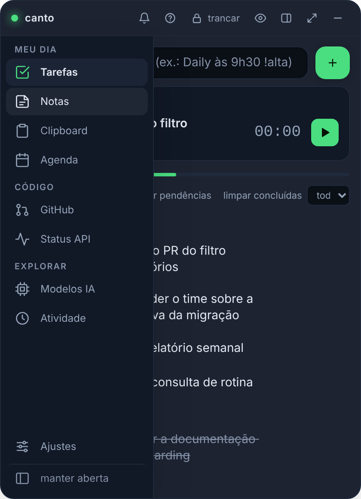 | 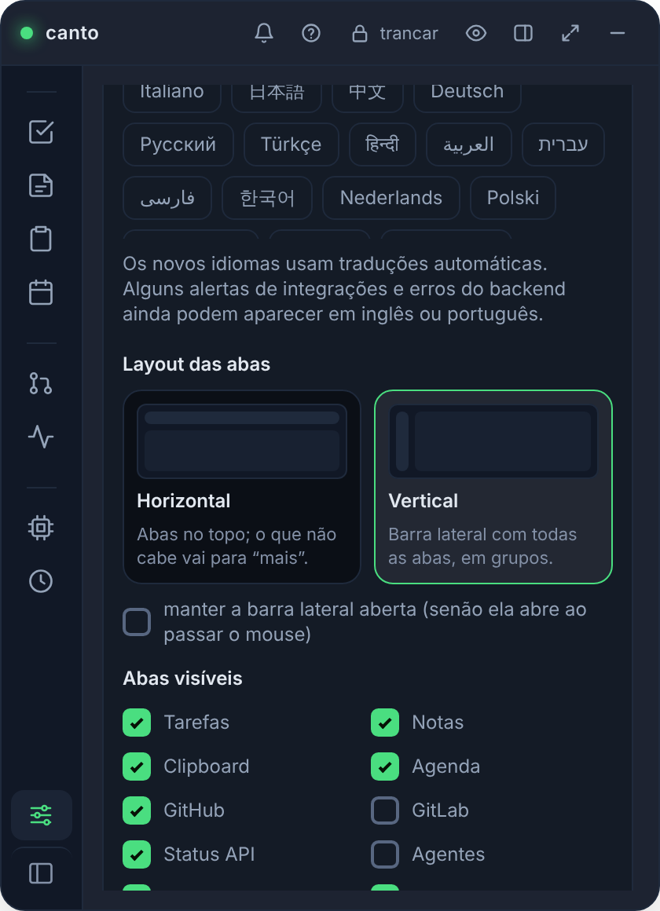 |

| Tasks: progress ring, priority chips, a menu for the rest | Notes: tag chips with counts, list or grid |
|---|---|
| 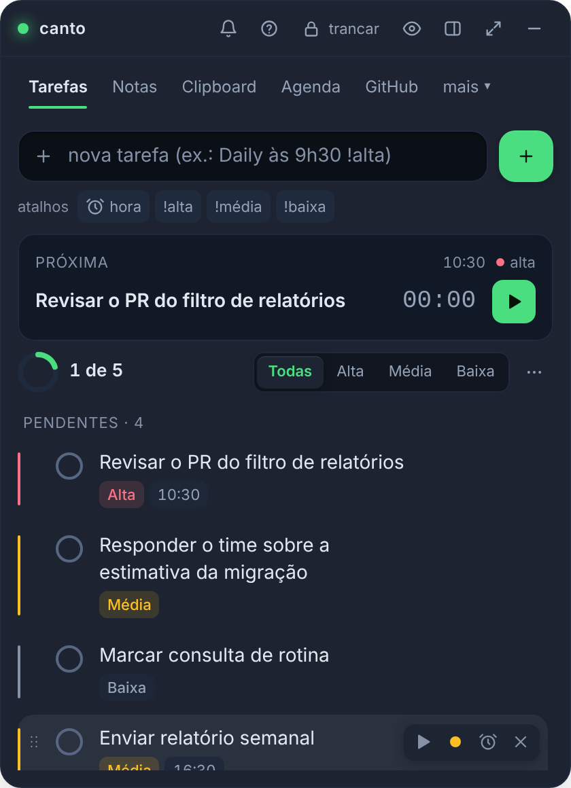 | 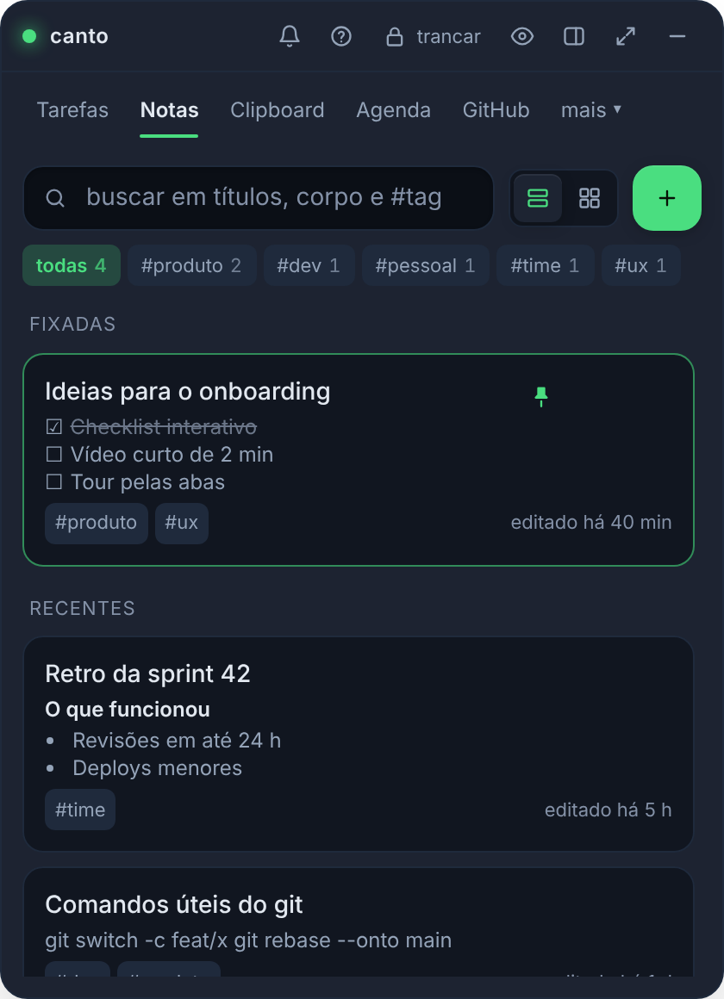 |

| Clipboard: type chips and cards by kind | Agenda: one control row and a countdown ring |
|---|---|
| 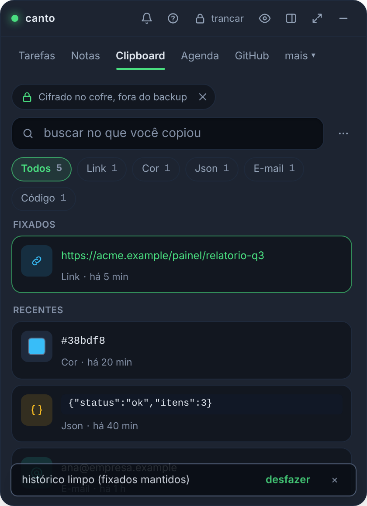 | 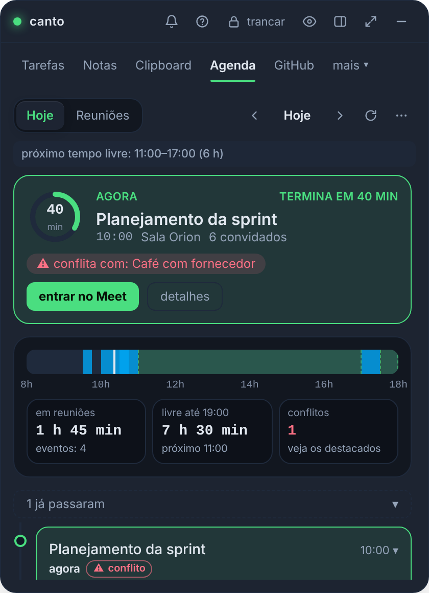 |

| GitHub: the numbers are filters | Status API: services by severity |
|---|---|
| 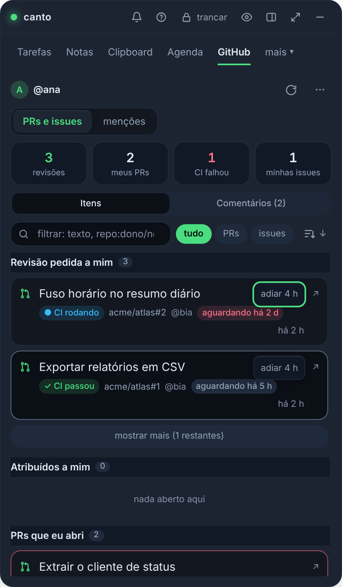 | 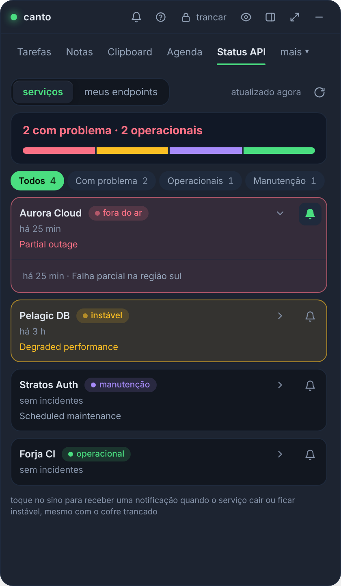 |

| Status API: my endpoints | AI models: sort chips | Activity: the focus goal |
|---|---|---|
| 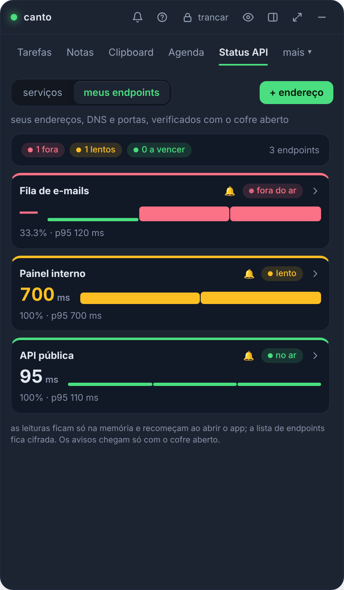 | 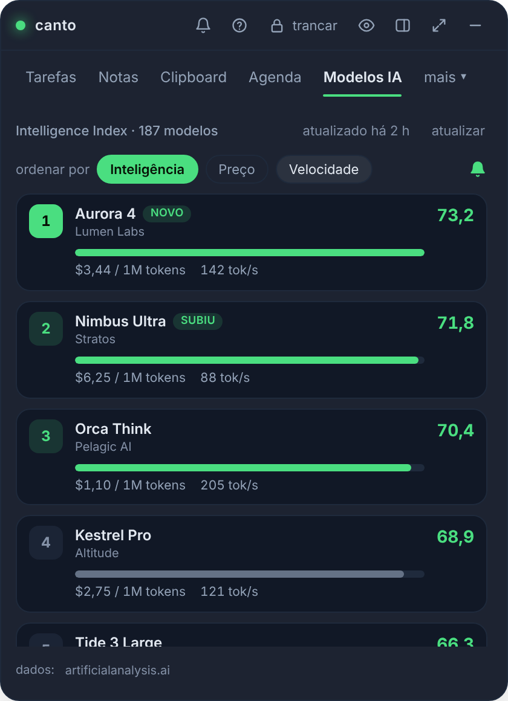 | 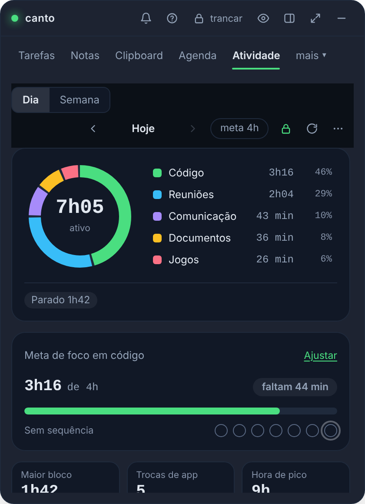 |

| Hry a celá obrazovka: upozornenia čakajú, kým odídete |
|---|
|  |

| Odloženie: 1, 5 alebo 10 minút |
|---|
|  |

| A window that fails shows itself instead of blocking clicks invisibly |
|---|
|  |

| Pripomenutie úlohy | Zmeniť hlavné heslo | Stav API (karta prihlásenia) | Jazyk: angličtina, portugalčina alebo španielčina |
|---|---|---|---|
|  |  |  |  |

| Skopírujte prepísaný klip | Upozornenie na stretnutie s prípravou |
|---|---|
|  |  |

| Zmena dizajnu: karta Úlohy, pred a po |
|---|
|  |

| Prepracovanie: každá karta, pred (hore) a za (dole) |
|---|
|  |

| CI zlyhala s nefunkčnými úlohami | Niekto ma spomenul | Ich prepínače v Nastaveniach |
|---|---|---|
|  |  |  |

| Uveďte upozornenie, kto to napísal |
|---|
|  |

| Upozornenie zmienky s náhľadom textu |
|---|
|  |

| Ďalšie upozornenia o mojej vlastnej práci |
|---|
|  |

| PR assigned to me |
|---|
|  |

| Súhrnné denné upozornenie | Nastavenie súhrnu dňa |
|---|---|
|  |  |

| Podkarta zmienky (GitHub a GitLab) |
|---|
|  |

| Heslo zmenené, čaká sa na jeden súbor | Zhrnutie dňa |
|---|---|
|  |  |

| Týždenná správa | Agenda: ďalší voľný čas a konflikty |
|---|---|
|  |  |

| Agenda: zadarmo hneď teraz | Paleta príkazov (`Ctrl+Shift+P`) |
|---|---|
|  |  |

| Nerušiť | Obrázok v poznámke |
|---|---|
|  |  |

| Odznak CI na každom PR | Oznámenia o preskúmaní žiadostí |
|---|---|
|  |  |

| Poznamenajte si obrázky ako miniatúry | WYSIWYG editor poznámok |
|---|---|
|  |  |

| Editor poznámok: raw markdown (MD) | Editor poznámok na svetlej koži |
|---|---|
|  |  |

| Úlohy: priorita v riadku, zalomenie dlhých nadpisov | Zoznam poznámok s vykresleným označením |
|---|---|
|  |  |

| Modely AI zoradené podľa Intelligence Index |
|---|
|  |

| Steam: najpredávanejšie, očíslované | Steam: posledných päť odohraných zápasov s oboma hracími časmi |
|---|---|
|  |  |

| Steam: katalóg podľa hodnotenia, s "načítať viac" | | Steam: the library, most played first, with a search box |
|---|---|
|  |  |

| Jedno prekrytie výstrahy pre všetko čakajúce: výpadky, stretnutia, úlohy a nové modely AI |
|---|
|  |

</details>

| Moje koncové body: dlaždice s najnovšou latenciou | Otvorený koncový bod: graf latencie, limit a nastavenia upozornení | Pridanie kontroly certifikátu DNS + |
|---|---|---|
|  |  |  |

| Agenda ľubovoľného dňa: šípky predchádzajúceho a nasledujúceho dňa, výber dátumu a tlačidlo späť na dnešný deň |
|---|
|  |

| Úlohy: aktuálna úloha s časovačom a zoskupeným zoznamom | GitHub: súhrnný pás nad zoznamami | GitLab: rovnaký pás, bez dlaždice CI |
|---|---|---|
|  |  |  |

| Časovač zaostrenia pripnutý pod každou záložkou | Program ako deň, úlohy popri stretnutiach |
|---|---|
|  |  |

| Zobrazenie dňa: prekrývajúce sa udalosti zdieľajú šírku vedľa seba |
|---|
|  |

| Kontrola radaru: najskôr najstaršia žiadosť, oneskorená červená, odložiť |
|---|
|  |

| Stretnutia ako podkarta programu, vedľa položky Zoznam a deň |
|---|
|  |

| Záložka Aktivita (štandardne vypnutá) | Zhrnutie so zameraním času a uzavreté PRs/MRs |
|---|---|
|  |  |

| Karta aktivity, posledných 7 dní | Karta Aktivita, vypnutá | Karta aktivity v širokom okne |
|---|---|---|
|  |  |  |

Karta **Aktivita** sa spustí skrytá (zapnite ju v časti Nastavenia → viditeľné karty). Zaznamenáva iba názov
zameraná aplikácia, keď používate počítač, v zapečatenom lokálnom súbore, ktorý nikdy nedosiahne zálohy ani synchronizáciu (Wayland
nemôže nahlásiť zaostrené okno, takže tam zostane nedostupné). Vypnuté, kým sa neprihlásite a na prvej obrazovke sa nezobrazí čo
je zachované a čo nikdy nie je.

- **Deň**: šiška podľa kategórie s celkovým počtom vnútri, ktorej legenda ukrýva kategóriu, zmenu oproti dňu
pred a čas nečinnosti (bez klávesnice alebo myši po dobu 2 minút). Pod ním denný cieľ zameraný na kód s pruhom a
jedna bodka za deň, tri zvýraznenia (najdlhší úsek v jednej aplikácii, prepínanie aplikácií, hodina špičky), časová os, kde
deň, nečinnosť sa tiahne a najvyťaženejšie aplikácie zdieľajú jednu časovú os so značkou „teraz“ a zoznamom aplikácií
(klepnutím na jednu zmeníte jej kategóriu) alebo úloh, pri ktorých sa spúšťal časovač zaostrenia.
- **Týždeň**: zoskupené stĺpce za deň s priemernou čiarou a bodkou pod každým dňom, ktorý splnil cieľ, hodinová teplotná mapa
s vaším vrcholom a rovnaké zoznamy na celý týždeň.
- **Rozloženie a vzhľady**: jeden stĺpec v predvolenom okne, dva, keď je široké (maximalizované); každá koža má svoje
farby kategórie, skontrolovaný kontrast. Menu vedľa dňa ho skopíruje ako text.

<sub>Všetky snímky obrazovky používajú fiktívne údaje.</sub>

## ⚖️ V porovnaní s tým, čo je vonku

Žiadny zo skúmaných nástrojov nepokrýva viac ako dve z týchto frontov naraz. Zdroje a podrobnosti v
[docs/benchmark.md](docs/benchmark.md).

| | Úlohy + pripomienka | Poznámky | Schránka | Stretnutia | GitHub | Predvolene lokálne šifrovanie |
|---|:-:|:-:|:-:|:-:|:-:|:-:|
| **Canto** | ✅ | ✅ | ✅ | ✅ | ✅ | ✅ |
| Todoist / TickTick | ✅ | ➖ | — | — | — | — |
| Obsidián / Joplin | ➖ | ✅ | — | — | — | ➖ iba synchronizácia |
| Raycast | ➖ | ✅ | ✅ | ➖ | ➖ | ? |
| CopyQ / Ditto | — | — | ✅ | — | — | ➖ voliteľné |
| MeetingBar | — | — | — | ✅ | — | neuvádza sa |
| Gitify | — | — | — | — | ✅ | neuvádza sa |

<sub>✅ natívne · ➖ čiastočné, cez rozšírenie alebo voliteľné · — žiadne · ? nepublikované · neukladá údaje používateľa</sub>

Čo tu benchmark priniesol: **čas priamo v názve úlohy** (Todoist/TickTick), **odloženie upozornenia**
(TickTick) a **schránka, ktorá rešpektuje správcov hesiel** (CopyQ/Ditto).

## ⬇️ Nainštalujte

Stiahnite si inštalačný program pre vašu platformu z **[Releases](https://github.com/juninmd/canto-widget/releases)**:

| Systém | Súbor |
|---|---|
| 🪟 Windows 10/11 | `Canto_x.y.z_x64-setup.exe` (odporúčané) alebo `.msi` |
| 🍎 macOS | `.dmg` pre Apple Silicon alebo Intel |
| 🐧 Linux | `.AppImage`, `.deb` alebo `.rpm` |

1. Pri prvom spustení si vytvoríte **hlavné heslo**. Neexistuje žiadna obnova: stratíte heslo, stratíte údaje.
2. `Ctrl+Alt+Space` (`Cmd+Shift+Space` v systéme macOS) zobrazí a skryje miniaplikáciu.
3. Hotovo. Keď sa odošle nová verzia, Canto vás upozorní a **Nastavenia → Aktualizácie** sa aktualizujú jedným kliknutím.

> [!POZNÁMKA]
> Inštalačné programy ešte nie sú podpísané kódom: SmartScreen (Windows) a Gatekeeper (macOS) varujú pri prvom spustení.
> Automatické aktualizácie sú pred spustením overené podľa vlastného podpisu projektu.

Hotové manifesty pre winget a Homebrew (plus kostra pre Flatpak, momentálne zablokovaná) žijú v
[`packaging/`](packaging/README.md) – pripravené a overené lokálne, ale zatiaľ nebolo zverejnené
repozitáre: publikovanie je manuálne rozhodnutie a činnosť správcu.

## 🔒 Bezpečnosť na prvý pohľad

| Vrstva | Ochrana |
|---|---|
| Trezor | Argon2id (19 MiB, t=2) → AES-256-GCM, nový raz pri každom zápise, atómový zápis s `fsync` |
| Kľúč | Iba RAM, vynulované na uzamknutie; konfigurovateľný automatický zámok (5 až 60 minút nečinnosti, 15 minút štandardne) |
| Sieť | iba proces Rust hovorí do siete; webview nemá vzdialený pôvod (CSP) a nikdy nevidí tokeny |
| Google | voliteľné, iba `calendar.events.readonly`, `directory.readonly` (fotografie kolegov z pracovného priestoru v zozname hostí) plus profil, OAuth s PKCE a spätnou slučkou |
| GitHub | voliteľný, šifrovaný token; položky sa otvárajú iba vtedy, ak je odkaz `https://github.com/` |
| GitLab | voliteľná, šifrovaná adresa a token; Iba `https://`, žiadne presmerovania, odkazy iba z nakonfigurovanej inštancie |
| Aktualizácie | nainštaluje iba balík podpísaný kľúčom projektu; narušené sťahovanie sa pred spustením zahodí |

Úplný model, zálohovanie, zlúčenie medzi počítačmi a umiestnenie každého súboru: [docs/seguranca.md](docs/seguranca.md).
Našli ste chybu? [SECURITY.md](SECURITY.md).

## 📚 Dokumentácia

| Dokument | Čo je v ňom |
|---|---|
| 📖 [User guide](docs/uso.md) | karty, opakujúce sa úlohy, skratky, vzhľady, dostupnosť, okno, aktualizácie a štart so systémom |
| 📱 [Mobile](docs/mobile.md) | Android / iOS |
| 🔌 [Integrations](docs/integracoes.md) | Google agenda a GitHub (osobný token alebo tok zariadení) |
| 🛡️ [Security and data](docs/seguranca.md) | model hrozby, `.canto` zálohovanie, zlúčenie, zmena hesla, súbory na disku |
| 📊 [Benchmark](docs/benchmark.md) | Todoist, TickTick, Obsidian, Joplin, Raycast, PowerToys, CopyQ, Ditto, MeetingBar, Gitify a objemové testy |
| 📝 [CHANGELOG](CHANGELOG.md) | čo sa zmenilo v každej verzii |
| 🤝 [How to contribute](CONTRIBUTING.md) | prostredie, testy, PRs a ako publikovať vydanie |
| 🤖 [Agent guide](AGENTS.md) | zmluvy a pasce pre každého, kto upravuje kód pomocou AI |

## 🛠️ Vývoj

Predpoklady: [Bun](https://bun.sh) ≥ 1,2, stabilné Rust ≥ 1,85 a
[Tauri v2 dependencies](https://v2.tauri.app/start/prerequisites/) pre váš systém.

```bash
bun install
bun run tauri dev                                        # app with hot reload
bun run lint && bun test                                 # types and UI tests
bun run build && cd src-tauri && cargo clippy --all-targets -- -D warnings && cargo test
bun run tauri build                                      # installer for the current platform
```

Webviews sa vytvárajú po stave Rust a zásobník je inicializovaný, takže spúšťacie IPC volania nemôžu pretekať.

Každý PR spúšťa CI v systémoch Windows, MacOS a Linux. Konvenčné `fix`, `feat` a porušujúce odovzdania sa zlúčili do `main`
získať značku SemVer, vygenerované poznámky k vydaniu a podpísané inštalačné programy postavené paralelne; vydanie je zverejnené po overení (podrobnosti v
[CONTRIBUTING.md](CONTRIBUTING.md#publicar-uma-versão)).

## 📄 Licencia

[MIT](LICENSE) © Antonio Carlos

<div align="center"><sub>Vyrobené s 🦀 Rust, ⚛️ React a ☕ pre tých, ktorí žijú medzi stretnutiami.</sub></div>
