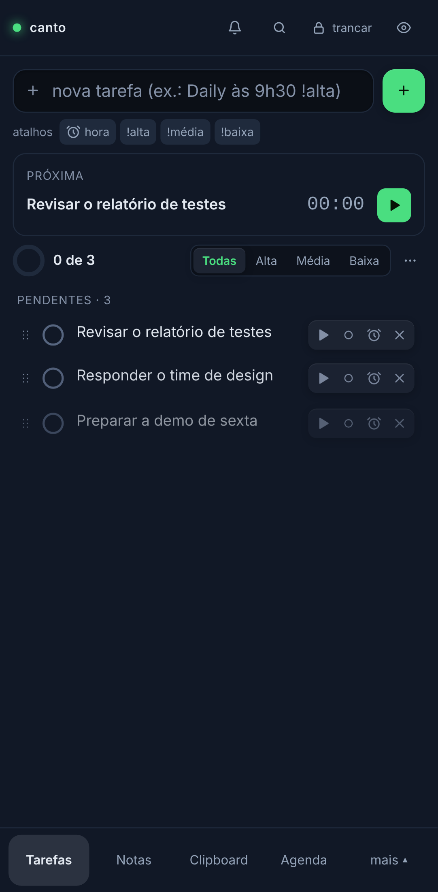
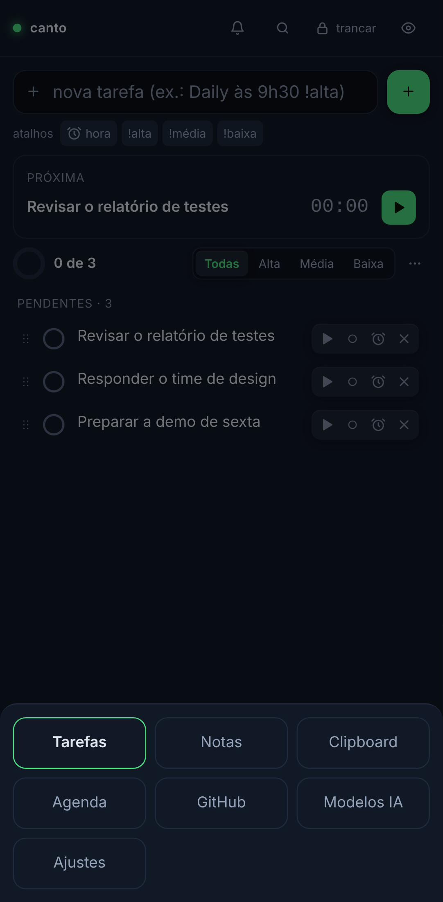
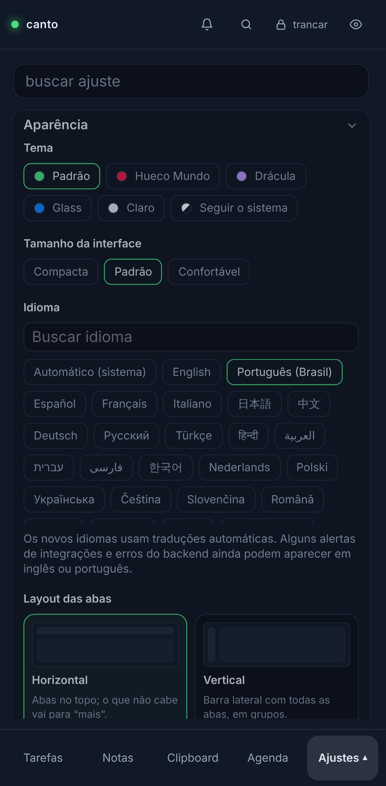

# Canto no celular (Android e iOS)

O app de celular é o mesmo código do desktop: o mesmo Rust (cofre cifrado, GitHub, Google, Steam…) e a mesma UI
React, empacotados pelo Tauri v2 Mobile. O que muda é a casca: a janela flutuante vira uma tela cheia, as abas
vão para uma barra embaixo e o que só existe num computador sai de cena.

  

## O que é igual

Tarefas (com lembrete, recorrência, subtarefas, foco), Notas, Clipboard, Agenda, GitHub, GitLab, Status API,
Modelos de IA, Agentes, Clima, Mercado, Steam, Leituras, Gmail, Drive, Contatos e Ajustes; a senha mestra, o
bloqueio automático, o modo privacidade, o backup `.canto` (e a mesma mesclagem entre aparelhos), os avisos como
notificações do sistema e os 45 idiomas.

## O que só existe no computador

| Recurso | No celular |
|---|---|
| Janela no canto, mini, tela cheia, sempre na frente | a tela é do app |
| Bandeja, atalhos globais, captura rápida, início com o sistema | não há equivalente |
| Aba Atividade (app em foco) | oculta |
| Pasta sincronizada | oculta: use o backup `.canto` |
| Atualização dentro do app | a loja atualiza |
| Windows Hello / Touch ID | ainda não: o cofre abre com a senha mestra |

## Diferenças de comportamento

- **Clipboard**: no celular não há vigia em segundo plano (o iOS mostra um aviso a cada leitura e o Android sinaliza
  leituras em segundo plano). O que foi copiado é capturado quando a aba Clipboard aparece na tela.
- **Avisos**: tocam enquanto o app está aberto ou em segundo plano recente; o sistema pode suspender o app depois.
  Na primeira abertura o Canto pede a permissão de notificações.
- **Backup e exportar nota**: usam o seletor de arquivos do sistema (no Android, o gerenciador de documentos).

## Compilar

Pré-requisitos comuns: Bun, Rust estável e `bun install`.

### Android

Requer JDK 17+, Android SDK (plataforma 37) e NDK 27. Defina `ANDROID_HOME` e `NDK_HOME`.

```bash
rustup target add aarch64-linux-android armv7-linux-androideabi i686-linux-android x86_64-linux-android
bun run tauri android dev                   # no aparelho ou emulador, com hot reload
bun run tauri android build --apk           # APK; assine com a sua keystore para distribuir
```

O projeto Gradle fica versionado em `src-tauri/gen/android`.

### iOS (somente em um Mac, com Xcode)

```bash
rustup target add aarch64-apple-ios aarch64-apple-ios-sim
bun run tauri ios init                      # gera src-tauri/gen/apple (versione a pasta)
bun run tauri ios dev
bun run tauri ios build
```

Distribuir exige uma conta Apple Developer e o `developmentTeam` no `tauri.ios.conf.json`.

## Como o código se divide

- `#[cfg(desktop)]` / `#[cfg(mobile)]` no Rust: bandeja, atalhos, janelas, autostart, updater e a pasta sincronizada
  só compilam no desktop. A lista de comandos IPC é a mesma; os comandos de janela não existem no celular e a UI
  nunca os chama (`IS_MOBILE` em `src/lib/platform.ts`).
- `tauri.android.conf.json` e `tauri.ios.conf.json` trocam as três janelas do desktop por uma só.
- `capabilities/mobile.json` libera só o necessário; `capabilities/default.json` ficou restrito ao desktop.
- Caminhos de arquivo do seletor são URIs no celular: `src-tauri/src/picked.rs` abre pelo plugin `fs`.
- O CI compila e roda o clippy (`-D warnings`) do crate para Android e iOS a cada PR.
